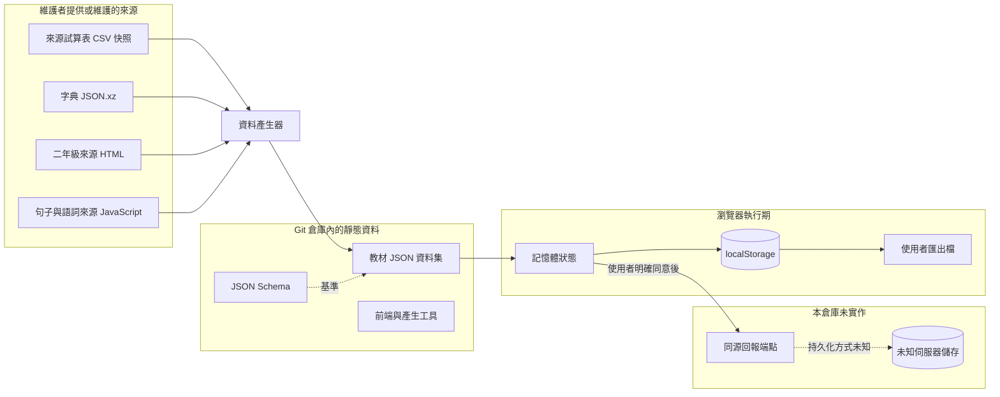
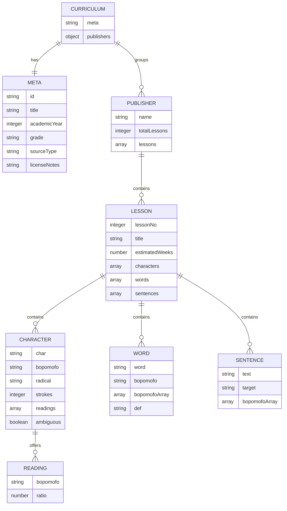

# 字在資料模型文件

> 本目錄是 `zizai-learning` 目前資料格式、資料關係、瀏覽器儲存與可見狀態轉換的工程文件。本文只記錄結構、型別與規則，不抄錄教材字詞、例句、來源識別碼、使用者資料或其他真實內容。

## 1. 文件目的與範圍

本文件回答下列問題：

1. 教材資料、來源輸入、衍生檔案與測試紀錄各使用什麼檔案格式。
2. 靜態 JSON 的正式 Schema、實作延伸欄位與歷史格式變體為何。
3. 專案是否有資料庫表；若沒有，邏輯上的「表」與瀏覽器儲存如何對應。
4. 教材選擇、學習進度、讀音覆寫、回報、練習、考卷與資料建置有哪些狀態及轉換。
5. 哪些規則可由 JSON Schema 驗證，哪些只能由產生器或語意測試驗證。

不在本文件範圍內：

- 不重述教材內容、字詞清單或例句。
- 不推定部署端 `/api/report` 的伺服器資料表；該端點的伺服器實作不在本倉庫。
- 不把 `src/app.js` 的臨時 JavaScript 變數名稱視為公開資料格式。
- 不把 `data/schema.json` 未宣告的延伸欄位誤稱為已通過正式 Schema 驗證。

## 2. 文件地圖

| 文件 | 內容 |
|---|---|
| [`README.md`](README.md) | 文件總覽、系統邊界、儲存模型與閱讀方式 |
| [`data-inventory.md`](data-inventory.md) | 全部資料檔、來源檔、衍生檔與檔案格式 |
| [`json-schema.md`](json-schema.md) | 正式 JSON Schema、欄位字典、關聯模型、格式變體與 invariants |
| [`browser-storage-and-runtime.md`](browser-storage-and-runtime.md) | `localStorage`、匯出格式、回報封裝、內嵌資料與執行期狀態 |
| [`state-machines.md`](state-machines.md) | 教材選擇、進度、讀音、練習、考卷與列印狀態機 |
| [`data-lineage-and-validation.md`](data-lineage-and-validation.md) | 來源到產物的 lineage、產生流程、驗證矩陣與已知落差 |

## 3. 系統資料邊界

### 3.1 沒有關聯式或 NoSQL 資料庫

本倉庫是靜態前端專案，**沒有資料庫 migration、資料表定義或後端持久層**。因此：

- `data/*.json` 是版本控制中的靜態資料集，可視為邏輯上的目錄資料表，但不是 SQL 表。
- 瀏覽器 `localStorage` 是使用者裝置上的鍵值儲存，不是跨使用者共用資料庫。
- 單檔離線版將 JSON 轉成 JavaScript 全域物件；仍不是資料庫。
- `/api/report` 只有前端呼叫契約，沒有可據以建立伺服器資料表的程式碼或 schema。
- 若未來新增伺服器資料庫，需另行提供 API schema、資料保留政策與遷移文件；不可從目前前端 payload 推定完整資料表。

## 4. 儲存模型總表

| 儲存類型 | 位置／鍵 | 生命週期 | 主要內容 | 穩定性 |
|---|---|---|---|---|
| 靜態教材資料 | `data/curriculum-*.json` | 隨部署版本更新 | 教材、單元、生字、詞語、例句、讀音候選 | 公開輸入格式；版本間可擴充 |
| JSON Schema | `data/schema.json` | 隨程式版本更新 | 基礎教材 JSON 的結構約束 | 僅涵蓋部分正式教材格式 |
| 內嵌教材 | `window.__EMBEDDED_*__` | 單檔 HTML 載入期間 | 打包時內嵌的教材 JSON | 打包工具內部介面 |
| 學習進度／偏好 | 瀏覽器 `localStorage` | 使用者裝置上持續保存 | 年級、版本、進度、精熟與不熟等狀態 | 邏輯狀態已知；v3 實際 envelope 應由前端實作核對 |
| 讀音覆寫 | `zizai:readingOverrides:v1` | 使用者裝置上持續保存 | 使用者選定的讀音、備註、教材脈絡與時間戳 | 已明確記錄的鍵值格式 |
| 執行期記憶體 | JavaScript `state` 與 DOM | 頁面載入至卸載 | 目前選項、載入快取、篩選、題目、考卷 DOM | 非公開持久格式 |
| 使用者匯出 | 純文字／JSON 檔 | 由使用者保存 | 讀音覆寫的可攜 representation | 匯出格式不應與內部儲存格式混淆 |
| 回報請求 | POST `/api/report` 的 JSON body | 單次網路請求 | 使用者選擇分享的讀音資訊與頁面環境 | 僅前端 payload 可確認；伺服器保存未知 |

## 5. 核心資料模型

這是實體關聯的**邏輯模型**，不是資料庫 ERD。正式欄位、型別及變體見 [`json-schema.md`](json-schema.md)。

## 6. 證據來源與可信度

| 主題 | 主要證據 | 限制 |
|---|---|---|
| 基礎 JSON 結構 | `data/schema.json` | 未宣告所有後來新增的欄位，也未涵蓋歷史版與體驗版根結構 |
| 正式教材產生行為 | `tools/build_grades_from_sources.py`、`tools/build_datasets.py` | 來源檔本身不在倉庫，需遵守授權並由維護者提供 |
| 執行期選項與流程 | `index.html`、`src/app.js`、`src/readings.js`、`src/zhuyin.js` | 臨時變數名稱可能隨重构改變 |
| 儲存與回報契約 | `src/readings.js` 既有測試與專案文件 | 服務端保存與資料表不在本倉庫 |
| 來源與授權說明 | `data/SOURCES.md`、`data/GAPS.md` | 授權判斷不能由程式文件取代權利人確認 |

## 7. 文件約定

- **必要**：在 `data/schema.json` 或對應產生器中為必填。
- **選填**：可有可無；不得以空值與未提供混為同一語意。
- **延伸欄位**：執行期已使用，但基礎 Schema 尚未宣告。
- **格式變體**：根物件或陣列組織方式不同，不能直接套用正式教材根 Schema。
- **不變條件（invariant）**：跨欄位或跨檔案必須成立的規則，通常需要語意測試。
- **實作狀態**：可由 UI 或函式觀察到的狀態，不一定等於持久化欄位。

## 8. 核心結論

1. 正式教材 JSON 的主幹是 `meta → publishers → lessons → characters/words/sentences`。
2. `readings`、`ambiguous`、`rendu`、`wordsSource` 等是實作延伸，基礎 JSON Schema 尚未完整表達。
3. 110 學年度資料使用 `blocks`，體驗版使用 `themes`，兩者都是正式教材根格式的變體。
4. 瀏覽器有兩類本機狀態：教材學習進度，以及鍵名明確的讀音覆寫；前者不應被當作穩定匯出格式。
5. 讀音覆寫會影響卡片、詳情、練習與新產生的考卷；回報是另一條必須由使用者主動同意的狀態流程。
6. 本專案沒有資料庫表；所有跨使用者保存需求都超出目前倉庫可證實範圍。
7. 來源資料不可因能讀入就推定可再散布；授權狀態與資料結構是兩個獨立問題。
