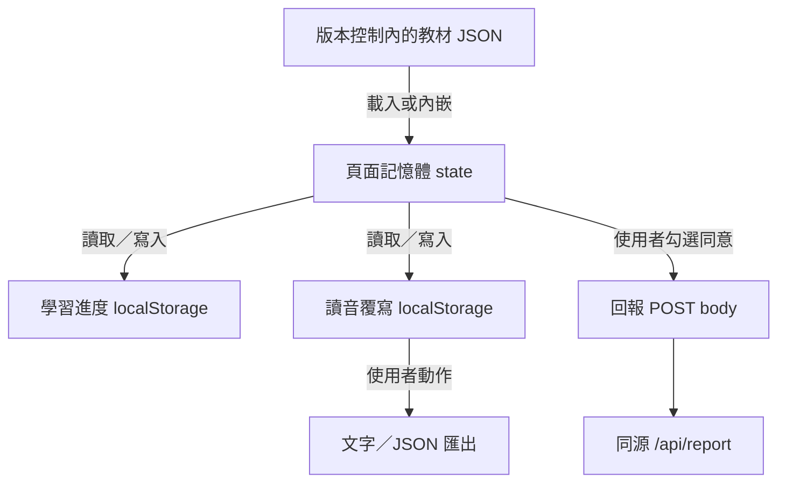
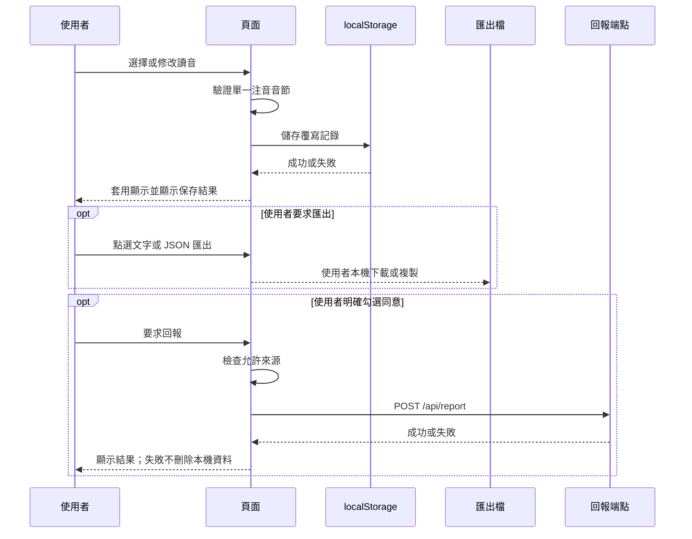

# 字在瀏覽器儲存與執行期資料模型

## 1. 儲存層總覽



| 類別 | 是否持久 | 是否可攜 | 是否可跨使用者共享 |
|---|---|---|---|
| 教材 JSON | 是，隨部署 | 是 | 是，唯讀 |
| 學習進度 | 是，瀏覽器／裝置 | 不應視為穩定格式 | 否 |
| 讀音覆寫 | 是，瀏覽器／裝置 | 可透過匯出 | 否 |
| 回報 payload | 單次傳輸 | 不應視為資料集 | 只有在使用者同意後才送出 |

## 2. 教材資料載入模型

### 2.1 網頁版

網頁版透過 HTTP `fetch` 讀取 `data/*.json`。已確認的執行期識別如下：

| 識別 | 型別 | 意義 |
|---|---|---|
| `state.currentGrade` | 年級識別 | 目前選取年級 |
| `state.gradeData` | object/map | 已載入教材的快取，key 為年級 |
| `state.curriculum110` | object/null | 歷史教材資料 |
| `state.curriculumDemo` | object/null | 體驗版資料 |
| `GRADE_DATA_FILES` | object/map | 年級到現行教材檔案的對應 |

載入結果應建模為：

| 狀態 | 意義 | 可執行操作 |
|---|---|---|
| `not-loaded` | 尚未取得該資料集 | 顯示載入狀態或觸發載入 |
| `loading` | 讀取／解析中 | 避免重複載入；停用依賴該資料的操作 |
| `ready` | 解析成功且基本結構可用 | 顯示教材、建立 lesson 選單與題庫 |
| `invalid` | JSON 可解析但結構不符 | 顯示錯誤，不把不完整資料當成有效教材 |
| `error` | 網路、檔案或解析失敗 | 顯示可理解的降級訊息 |

### 2.2 單檔離線版

單檔版將資料放在：

- `window.__EMBEDDED_GRADES__`
- `window.__EMBEDDED_CURRICULUM_110__`
- `window.__EMBEDDED_CURRICULUM_DEMO__`

此模式不需要 `fetch` 教材檔。其餘資料模型與網頁版相同；差異只在載入來源與網路請求面。

## 3. 學習進度與偏好儲存

學習進度使用瀏覽器 `localStorage`，已知儲存版本曾由 v2 遷移至 v3。基礎 JSON Schema 沒有定義這個 store，且它不是教材資料的公開交換格式。

### 3.1 邏輯資料模型

下表描述可由 UI 與現有功能確認的邏輯狀態，不宣稱其實際 JSON envelope、key 名稱或巢狀深度。

| 邏輯資料 | 基数 | 說明 |
|---|---|---|
| 年級 | 1 | 使用者目前操作年級 |
| 教材類型 | 1 | 現行、历史或體驗資料 |
| 出版社版本 | 1 | 目前選取的教材版本 |
| 自動估算進度 | 1 | 由學期起點、目前時間與課程估算 |
| 手動進度覆寫 | 0 或 1 | 明確指定目前單元；可清除回到自動估算 |
| 已精熟字集合 | 0 到多個 | 供「已精熟」篩選與顯示 |
| 待加強字集合 | 0 到多個 | 供「不熟生字」練習範圍 |
| 其他偏好 | 0 到多個 | 例如已保存的篩選；不應假定跨版本永久穩定 |

### 3.2 儲存限制

- `localStorage` 可能被瀏覽器停用、容量滿、內容損壞或被使用者清除。
- 讀取失敗時應回退到無本機進度的安全狀態，而非讓整頁停止。
- 寫入失敗時應保留目前記憶體狀態，並提示使用者匯出需要保存的讀音修改。
- 清除網站資料、換瀏覽器或換裝置後，進度不會自動同步。
- v2 到 v3 的遷移應可重入；舊格式無法辨識時應丟棄該份進度，不得猜測。

### 3.3 不應實作的行為

- 不把整份教材 JSON 複製到 `localStorage`。
- 不把使用者讀音修改、學習進度與回報紀錄混成同一物件。
- 不把 `localStorage` 視為唯一資料來源；使用者匯出才是可攜備份。
- 不在 log、錯誤訊息或 URL query 中記錄完整本機狀態。

## 4. 讀音覆寫儲存

### 4.1 固定鍵名

```text
zizai:readingOverrides:v1
```

值是以字元為 key 的 map。

### 4.2 結構

```json
{
  "<character>": {
    "bopomofo": "<validated-single-syllable>",
    "note": "<optional-note>",
    "ts": "<timestamp>",
    "grade": "<grade-context>",
    "publisher": "<publisher-context>",
    "lesson": "<lesson-context>",
    "dict": "<optional-original-reading>"
  }
}
```

上式只表示欄位型別；尖括號不是實際值。

| 欄位 | 型別 | 必要 | 說明 |
|---|---|---|---|
| map key | string | 是 | 被覆寫的單一字元；作為記錄識別 |
| `bopomofo` | string | 是 | 使用者選定或自行輸入並通過驗證的單一注音音節 |
| `note` | string | 是 | 選填語意上的備註；最多 100 字 |
| `ts` | string/number | 是 | 覆寫時間戳；實際型別與單位由 `readings.js` 定義 |
| `grade` | string/number | 是 | 建立覆寫時的年級脈絡 |
| `publisher` | string | 是 | 建立覆寫時的出版社版本 |
| `lesson` | integer/string | 是 | 建立覆寫時的單元脈絡 |
| `dict` | string | 否 | 覆寫當下的原讀音；用於精準替換與還原語意 |

### 4.3 注音驗證

允許的內容限於：

- 注音聲母、介音、韻母字元。
- 一個聲調符號 `ˊ`、`ˇ`、`ˋ` 或輕聲 `˙`。
- 輸入時可容忍空白，儲存前正規化。

規則：

1. 一個字只允許一個音節。
2. 最多一個聲調符號。
3. 一、二、三、四聲的調號位置必須符合注音規則。
4. 輕聲符號在顯示時正規化為字典常見的前置寫法。
5. 不合法輸入不得寫入 `localStorage`。
6. 缺少 `dict` 的舊記錄仍可使用，但替換語詞或句子時應採更保守的規則。

### 4.4 損壞與不可用處理

| 情況 | 應有結果 |
|---|---|
| `getItem` 拋錯 | 視為沒有覆寫資料，頁面仍可使用 |
| `setItem` 拋錯 | 不更新為已保存狀態，顯示本機保存失敗訊息 |
| `removeItem` 拋錯 | 記憶體可先還原，但提示磁碟狀態未能確認 |
| JSON 內容損壞 | 忽略損壞內容，不讓整頁當機 |
| 單筆欄位不合法 | 忽略該筆或降級為無效，不套用不合法讀音 |
| key 不存在 | 視為空 map |

## 5. 讀音覆寫的邏輯欄位與用途

| 欄位 | 主要用途 |
|---|---|
| `bopomofo` | 顯示卡片、詳情、練習、考卷與答案卷 |
| `note` | 讓使用者或教師知道覆寫原因；不得含不必要個人資料 |
| `ts` | 判斷新舊與匯出排序 |
| `grade` | 限定覆寫適用的教材脈絡 |
| `publisher` | 區分不同出版社的讀音差異 |
| `lesson` | 保留覆寫發生時的課次脈絡 |
| `dict` | 判斷句子或詞語中的音節是否原本就是該讀音，避免誤替換 |

## 6. 匯出格式

### 6.1 純文字匯出

純文字是給人閱讀的 representation，應至少區分：

- 被覆寫的字。
- 生效讀音。
- 覆寫前的字典讀音（若 `dict` 存在）。
- 教材脈絡。
- 備註。

它是可攜備份，不是 `localStorage` 的 byte-for-byte 保證。若未來需要程式匯入，應另提供明確版本與欄位契約。

### 6.2 JSON 匯出

JSON 匯出的邏輯內容是讀音覆寫記錄。現行實作可能調整 envelope，因此消費端應：

1. 先辨識資料版本或根形狀。
2. 驗證每筆 `bopomofo`。
3. 忽略無法辨識的欄位，而非執行其中內容。
4. 不把匯出檔視為教材 JSON，也不得直接送入教材產生器。

## 7. 回報 payload

前端在使用者主動勾選同意後，才可能送出下列欄位：

| 欄位 | 說明 | 資料模型注意事項 |
|---|---|---|
| `app` | 應用識別；現行值為 `zizai` | 固定識別，不是使用者資料 |
| `kind` | 回報種類 | 固定列舉或版本化字串 |
| `message` | 要分享的讀音資訊 representation | 可能包含教材字詞；送出前需使用者同意 |
| `ref` | 補充參照 | 內容由前端契約定義 |
| `page` | 頁面脈絡 | 應避免放入不必要識別資訊 |
| `viewport` | 視窗尺寸 representation | 非教材資料 |
| `website` | 蜜罐欄位 | 正常送出應為空字串 |

傳輸條件：

1. 使用者明確勾選。
2. 執行來源符合前端允許清單。
3. 使用同源相對路徑 `/api/report`。
4. 傳輸失敗時保留本機覆寫，不阻斷學習功能。

本倉庫沒有伺服器端 schema、資料表、保存期限或刪除流程，因此不能對伺服器保存行為作背書。

## 8. 執行期記憶體狀態

| 邏輯狀態 | 型別／集合 | 來源 | 生命週期 |
|---|---|---|---|
| 目前年級 | scalar | 使用者選擇 | 頁面載入期間 |
| 教材類型 | scalar | 使用者選擇 | 頁面載入期間 |
| 出版社版本 | scalar | 使用者選擇 | 頁面載入期間 |
| 已載入教材快取 | map | JSON 載入 | 頁面載入期間 |
| 目前單元 | scalar | 自動估算或手動覆寫 | 頁面載入期間 |
| 字卡篩選 | enum | `all`、`current`、`unfamiliar`、`mastered` | 頁面載入期間 |
| 精熟／不熟字集合 | set-like | 學習互動或持久化進度 | 頁面載入期間；可回寫 |
| 讀音覆寫 map | map | `localStorage` | 頁面載入期間；可回寫 |
| 練習範圍 | enum | `current`、`all-taught`、`unfamiliar` | 練習進行期間 |
| 練習題數 | integer | 使用者設定 | 練習進行期間 |
| 練習目前題目／結果 | scalar／collection | 抽題與作答 | 練習進行期間 |
| 考卷設定 | object | 標題、題數與顯示開關 | 考卷產生期間 |
| 考卷 DOM | DOM tree | 抽題與渲染 | 列印或重新出題前 |
| 使用者回報狀態 | enum | 同意與網路結果 | 單次回報流程 |

## 9. 資料流與隱私邊界



本機保存、回報與公開教材資料是三條不同資料流。任何匯入、合併或回報功能都不得因便利而混用三者的授權與同意條件。
