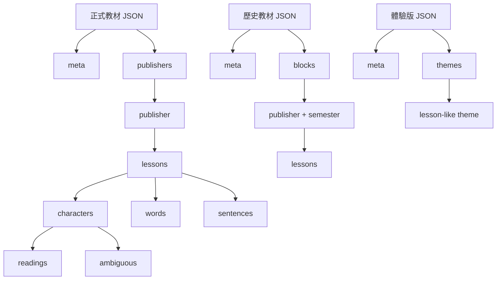

# 字在資料檔與檔案格式清單

> 本文件盤點倉庫內、工具產生、測試使用及維護者需另行提供的檔案。只記錄格式與語意，不列真實教材或來源內容。

## 1. 倉庫內的靜態資料

| 路徑 | 格式 | 根結構／主要內容 | 產生或維護方式 | 驗證狀態 |
|---|---|---|---|---|
| `data/schema.json` | JSON Schema 2020-12 | `meta`、`publishers` 的基礎 Schema | 手動維護 | 可作基礎格式驗證，但不是完整契約 |
| `data/curriculum-115-1.json` | UTF-8 JSON | 正式教材根結構；二年級 | `tools/build_datasets.py` 或既有資料維護 | 有既有資料與邏輯測試 |
| `data/curriculum-115-1-g1.json` | UTF-8 JSON | 正式教材根結構；一年級 | `tools/build_grades_from_sources.py` | 有欄位、來源快照與讀音測試 |
| `data/curriculum-115-1-g3.json` | UTF-8 JSON | 正式教材根結構；三年級 | 同上 | 同上 |
| `data/curriculum-115-1-g4.json` | UTF-8 JSON | 正式教材根結構；四年級 | 同上 | 同上 |
| `data/curriculum-115-1-g5.json` | UTF-8 JSON | 正式教材根結構；五年級 | 同上 | 同上 |
| `data/curriculum-115-1-g6.json` | UTF-8 JSON | 正式教材根結構；六年級 | 同上 | 同上 |
| `data/curriculum-110.json` | UTF-8 JSON | `meta`、`blocks` 的歷史格式變體 | `tools/build_datasets.py` | 尚無獨立完整 Schema |
| `data/curriculum-demo.json` | UTF-8 JSON | `meta`、`themes` 的體驗格式變體 | `tools/build_datasets.py` | 尚無獨立完整 Schema |
| `data/SOURCES.md` | Markdown | 來源、輸入位置與授權說明 | 手動維護 | 文件，不屬於執行期資料 |
| `data/GAPS.md` | Markdown | 已知資料缺口與人工確認項目 | 手動維護／由檢查流程更新 | 文件，不屬於執行期資料 |

### 1.1 JSON 的共同解析規則

- 以 JSON 解析器讀取；格式驗證不依賴縮排、鍵順序或檔案結尾換行。
- 教材資料檔是發布輸入，屬於可部署的靜態資產。
- `data/schema.json` 是結構描述，不是資料內容；它不列舉字、詞或例句。
- `publishers` 使用物件，publisher key 是程式中的穩定識別碼；顯示名稱另存於 `name`。
- `lessons`、`characters`、`words`、`sentences` 與 `readings` 是有序陣列；顯示、抽題與列印可能依賴順序。

## 2. 正式教材 JSON 的資料族

| 資料族 | 根鍵 | 內容範圍 | 正式 Schema 相容性 |
|---|---|---|---|
| 現行出版社教材 | `meta`、`publishers` | 115 學年度上學期各年級 | 基礎結構相容；延伸欄位因 Schema 未禁止額外屬性而可存在 |
| 歷史教材 | `meta`、`blocks` | 110 學年度二年級歷史資料 | 不相容：缺少 `publishers`，多出 `blocks` |
| 體驗資料 | `meta`、`themes` | 依主題組織的自編練習 | 不相容：缺少 `publishers`，多出 `themes` |

## 3. 維護者提供、但未收入倉庫的來源輸入

這些檔案是重建資料的輸入，不是發布產物。缺少時產生器應明確失敗，且不得默認使用未驗證的替代資料。

### 3.1 教材分頁 CSV 快照

| 項目 | 說明 |
|---|---|
| 預期目錄 | `data/sources/gsyan/` |
| 檔名 | 依版本與年級命名的 15 個 `.csv` 檔 |
| 編碼 | 試算表匯出的文字；讀取時應能處理一般 UTF-8 CSV |
| 邏輯記錄 | 每個資料列對應一個教材單元 |
| 主要欄位位置 | 第一欄為包含學年度、版本、學期階段與單元鍵的複合標籤；第二欄為該單元的生字序列 |
| 單元鍵 | 正式課使用數字型課碼；另有部分無課碼的前導單元 |
| 轉換 | 每列保留為一個 lesson；生字順序依來源列順序 |
| 驗證 | 快照列數應等於 JSON 單元數；逐課生字集合應等於來源 |
| 授權 | 依 `data/SOURCES.md` 的授權狀態處理；結構可用不代表可散布 |

前導單元的來源標籤可能有兩種：

- 數字課碼型：可映射為非負 `lessonNo`。
- 無課碼型：依來源列順序配置負數 `lessonNo`，確保排在正式課前且不撞號。

### 3.2 字典資料

| 項目 | 說明 |
|---|---|
| 預期目錄 | `data/sources/moedict/` |
| 原始檔 | `dict-revised.json.xz` |
| 壓縮格式 | XZ；產生流程可先解壓成 JSON |
| JSON 邏輯結構 | 詞條陣列；每筆含詞目、讀音異體、釋義、部首、筆畫等屬性 |
| 產生器使用 | 單字屬性、異體讀音與多字詞條；詞頻由產生器從可用詞條計算，不視為來源檔的固定欄位 |
| 驗證 | 生字必要屬性非空；主讀音與選出的詞語讀音一致；多音字占比可重算 |
| 授權 | 依 `data/SOURCES.md`；原檔不隨本倉庫散布 |

本文件刻意不列出來源詞條內容或真實讀音。

### 3.3 二年級來源 HTML

| 項目 | 說明 |
|---|---|
| 環境變數 | `ZIZAI_G2_HTML` |
| 檔案格式 | HTML 中嵌入 JavaScript 物件常數 |
| 解析標記 | `const DATA = { ... };` |
| 邏輯內容 | `publishers → lessons`；課次、標題、生字、認讀字、詞語與既有教材屬性 |
| 產出 | `data/curriculum-115-1.json` |
| 失敗行為 | 找不到輸入檔或解析標記時明確終止，不應產生半套資料 |

### 3.4 句子與語詞來源 JavaScript

| 項目 | 說明 |
|---|---|
| 環境變數 | `ZIZAI_KIMI_JS` |
| 檔案格式 | JavaScript 原始碼 |
| 解析標記 | `const jq=[ ... ];function by(` |
| 邏輯內容 | publisher、semester、lessons、lessonNo、words、sentences |
| 產出 | 二年級資料的句子／詞語補充，以及 `data/curriculum-110.json` 的 `blocks` |
| 失敗行為 | 輸入不存在、標記不存在或物件不可解析時明確終止 |

## 4. 前端、樣式與工具檔案格式

| 路徑／副檔名 | 執行環境 | 格式與角色 |
|---|---|---|
| `index.html` | 瀏覽器 | HTML5；頁面入口、資料載入與 UI 控制項 |
| `src/*.js` | 瀏覽器 | JavaScript；注音、讀音管理與主程式 |
| `src/*.css` | 瀏覽器 | CSS；設計權杖、版面、元件、注音與列印 |
| `tools/*.py` | Python 3 | 資料產生、打包；僅使用標準函式庫為主 |
| `tools/*.mjs` | Node.js 22+ | ES module；本機 PDF 產生工具 |
| `tests/*.js` | Node.js | 資料與純邏輯測試 |
| `tests/*.mjs` | Node.js | 測試模組 |
| `*.md` | 人員閱讀 | Markdown 文件 |
| `*.txt` | 人員與 CI 閱讀 | 測試執行紀錄，不是機器輸入格式 |
| `.nojekyll` | 部署平台 | 空白部署標記 |
| `.gitignore` | Git | 忽略規則；尤其排除未核准散布的來源快照 |

## 5. 衍生與內嵌格式

### 5.1 單檔離線 HTML

`tools/bundle.py` 產生：

- `dist/index.html`
- `dist/zi-zai.html`

兩份檔案內容相同。格式為 HTML5，但 CSS、JavaScript 與教材資料均已內嵌。

| 內嵌 JavaScript 全域 | 型別 | 內容 |
|---|---|---|
| `window.__EMBEDDED_GRADES__` | 物件 | 以年級字串為 key 的現行教材資料集 |
| `window.__EMBEDDED_CURRICULUM_110__` | 物件 | 歷史教材資料集 |
| `window.__EMBEDDED_CURRICULUM_DEMO__` | 物件 | 體驗版資料集 |

打包規則：

1. 每個資源替換必須恰好命中一次。
2. 內嵌 JavaScript 只允許一處受控的同源回報呼叫。
3. 不允許未列入白名單的外部網址或其他網路傳輸 API。
4. 產生後不得殘留 `src/` 資源參照或外部字型 `<link>`。

### 5.2 範例 PDF

| 檔案 | 內容 |
|---|---|
| `dist/sample-worksheet.pdf` | 學生卷；由同一份已出題 DOM 隱藏答案卷後列印 |
| `dist/sample-worksheet-with-answers.pdf` | 學生卷加答案卷 |

PDF 是列印衍生物，不是教材資料來源；解析 PDF 不應取代讀取 JSON 資料模型。

### 5.3 使用者讀音匯出

| 產物 | 格式 | 用途 |
|---|---|---|
| 複製文字 | 純文字 | 供使用者閱讀、貼到可控管道或人工檢查 |
| 下載 JSON | JSON | 本機保存讀音覆寫；不上傳 |

匯出 envelope 的穩定性低於 `localStorage` 內部格式；消費端應依欄位語意處理，而不是依賴鍵順序或版面文字。

## 6. 測試資料與紀錄

| 路徑 | 格式 | 角色 |
|---|---|---|
| `tests/test_zizai.js` | JavaScript | 主要資料與邏輯驗證 |
| `tests/test_fmb_zhuyin.test.mjs` | JavaScript ES module | 注音與狀態相關測試 |
| `tests/RESULT_1151001*.txt` | 純文字 | 各輪實際測試輸出；歷史紀錄，不應被程式當成即時結果 |

測試可使用暫存目錄或無网络的假資料；不得連線正式服務，也不得把真實來源快照、憑證或個人資料複製進測試 fixture。

## 7. 檔案格式驗證矩陣

| 格式／產物 | 解析檢查 | 結構檢查 | 語意檢查 | 來源比對 |
|---|---|---|---|---|
| 現行教材 JSON | JSON parser | `data/schema.json` 加延伸規則 | 課次、字數、讀音、占比、詞語一致性 | CSV 快照逐課比對 |
| 歷史教材 JSON | JSON parser | 尚缺獨立 Schema | 應確認 blocks 與 UI 使用契約 | 來源 JavaScript |
| 體驗版 JSON | JSON parser | 尚缺獨立 Schema | 主題數、字數、詞數與 metadata 一致 | 產生器常數／輸入 |
| `data/schema.json` | JSON parser | JSON Schema meta-validation | 與實際資料 drift 檢查 | 不適用 |
| 單檔 HTML | HTML／瀏覽器載入 | 內嵌全域與資源順序 | 零未核准外部請求、打包一致性 | 來源 HTML、JS、JSON |
| 讀音覆寫 JSON | JSON parser | 欄位與注音格式 | 單一音節、聲調位置、備註長度 | `localStorage` 內容 |
| 回報 body | JSON parser | 固定欄位集合 | 僅在使用者同意及允許來源下送出 | 伺服器端契約不在本倉庫 |
| PDF | PDF reader／列印預覽 | 頁數 | 學生卷不得洩漏答案 | 同一份考卷 DOM |

## 8. 維護注意事項

1. 新增資料檔時，應同步說明它是正式格式、格式變體，還是僅供內部工具的中間檔。
2. 新增欄位前先判斷是否需要進入 `data/schema.json`；目前 Schema 未禁止額外欄位，不代表額外欄位已被正式驗證。
3. 來源 CSV 與字典原檔不得因建置方便而加入版本控制。
4. `dist/`、PDF 與測試結果都是可再生的衍生物，不能反向當成權威教材資料。
5. 歷史版與體驗版的根結構不同，消費者應依資料集類型分派，不應假設所有 `curriculum-*.json` 都有 `publishers`。
