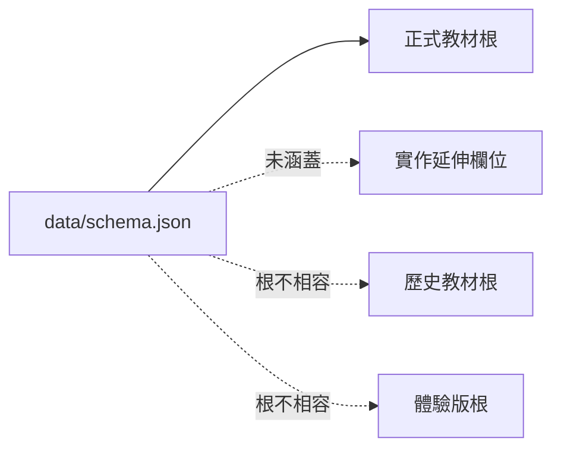

# 字在 JSON Schema 與欄位字典

## 1. Schema 分層

目前 JSON Schema 有三個層次：

1. **基礎正式教材 Schema**：`data/schema.json`，Draft 2020-12，描述 `meta → publishers → lessons`。
2. **實作延伸**：基礎 Schema 未宣告，但產生器或前端已使用的欄位。
3. **格式變體**：歷史教材與體驗版根結構不同，不能直接以基礎 Schema 驗證。



## 2. 正式教材根結構

以下是結構示意；尖括號內容是型別占位符，不是實際資料。

```json
{
  "meta": {
    "id": "<string>",
    "title": "<string>",
    "academicYear": 0,
    "grade": "<string>",
    "semester": "<string>",
    "semesterCode": "<schema-allowed-code>",
    "semesterStart": "<string>",
    "sourceType": "official_curriculum",
    "editionNote": "<string>",
    "licenseNotes": "<string>",
    "moeDictUrlTemplate": "<string>",
    "moeStrokeUrlTemplate": "<string>",
    "eduCloudPediaTemplate": "<string>"
  },
  "publishers": {
    "<publisher-key>": {
      "name": "<publisher-name>",
      "totalLessons": 0,
      "lessons": [
        {
          "lessonNo": 0,
          "title": "<string>",
          "estimatedWeeks": 0,
          "characters": [
            {
              "char": "<single-character>",
              "bopomofo": "<bopomofo-syllable>",
              "radical": "<string>",
              "strokes": 0,
              "def": "<optional-string>",
              "strokeImg": "<optional-string>",
              "moeDictUrl": "<optional-string>",
              "moeStrokeUrl": "<optional-string>",
              "readings": [
                {
                  "bopomofo": "<bopomofo-syllable>",
                  "ratio": 0.0
                }
              ],
              "ambiguous": false
            }
          ],
          "words": [
            {
              "word": "<string>",
              "bopomofo": "<optional-space-separated-bopomofo>",
              "bopomofoArray": ["<bopomofo-syllable>"],
              "def": "<optional-string>",
              "moeDictUrl": "<optional-string>"
            }
          ],
          "sentences": [
            {
              "text": "<string>",
              "target": "<string>",
              "bopomofoArray": ["<bopomofo-syllable>"]
            }
          ]
        }
      ]
    }
  }
}
```

`data/schema.json` 沒有設定 `additionalProperties: false`，所以實作延伸欄位可以存在，但「可以被 JSON Schema 接受」不等於「已被 Schema 明確定義」。

## 3. 根物件欄位

| 欄位 | 型別 | 基礎 Schema | 說明 |
|---|---|---|---|
| `meta` | object | 必要 | 資料集識別、學期、來源、授權與外部連結模板 |
| `publishers` | object | 必要 | publisher key 到教材版本的映射；每個值為 publisher 物件 |

## 4. `meta` 欄位

| 欄位 | 型別 | 基礎 Schema | 說明與限制 |
|---|---|---|---|
| `id` | string | 必要 | 資料集穩定識別碼；應在同型資料集中唯一 |
| `title` | string | 必要 | 顯示用資料集標題 |
| `academicYear` | integer | 選填 | 學年度；正式 Schema 未限制範圍 |
| `grade` | string | 選填 | 年級顯示值；正式 Schema 未限制列舉值 |
| `semester` | string | 選填 | 學期顯示值 |
| `semesterCode` | string | 選填 | 基礎 Schema 僅允許 `2a`、`2b`；見「Schema drift」 |
| `semesterStart` | string | 選填 | 學期起始日期表示；Schema 未強制日期格式 |
| `sourceType` | string | 必要 | `official_curriculum`、`historical_curriculum` 或 `demo_exercise` |
| `editionNote` | string | 必要 | 教材版本或資料彙整方式說明 |
| `licenseNotes` | string | 必要 | 來源與授權狀態說明；不可省略成空字串代替 |
| `moeDictUrlTemplate` | string | 選填 | 字典查詢連結模板 |
| `moeStrokeUrlTemplate` | string | 選填 | 筆順查詢連結模板 |
| `eduCloudPediaTemplate` | string | 選填 | 教育百科連結模板 |
| `wordsSource` | string | 延伸 | 產生器用來記錄詞語來源及篩選方式 |
| `themeCount` | integer | 體驗版延伸 | 主題數；應等於 `themes.length` |
| `uniqueCharCount` | integer | 體驗版延伸 | 不重複字數；由 `themes` 計算 |
| `totalWordCount` | integer | 體驗版延伸 | 詞語總數；由 `themes` 計算 |

### 4.1 `sourceType` 與根結構的對應

| `sourceType` | 預期根結構 | 現況 |
|---|---|---|
| `official_curriculum` | `publishers` | 基礎 Schema 主要目標 |
| `historical_curriculum` | `blocks` | 與基礎 Schema 根鍵不相容 |
| `demo_exercise` | `themes` | 與基礎 Schema 根鍵不相容 |

## 5. Publisher 欄位

| 欄位 | 型別 | 基礎 Schema | 說明 |
|---|---|---|---|
| `name` | string | 必要 | 教材版本顯示名稱 |
| `totalLessons` | integer | 必要 | 單元總數；應等於 `lessons.length` |
| `lessons` | array | 必要 | 有序單元陣列 |

### 5.1 Publisher key

`publishers` 是一個 map，而不是陣列。建議 key 僅使用程式內部穩定識別碼，顯示名稱由 `name` 提供。重新命名顯示名稱不應要求改 key；改 key 則會破壞既有呼叫端與打包流程。

## 6. Lesson 欄位

| 欄位 | 型別 | 基礎 Schema | 說明 |
|---|---|---|---|
| `lessonNo` | integer | 必要 | 單元編號；正式課通常為正數，前導單元可為零或負數 |
| `title` | string | 必要 | 顯示標題；前導單元可保留來源主題標籤 |
| `estimatedWeeks` | number | 選填 | 預估教學週數；可用小數 |
| `characters` | array | 必要 | 該單元生字；有順序性 |
| `words` | array | 必要 | 該單元詞語 |
| `sentences` | array | 選填 | 該單元例句；缺少時前端不應產生空白題型 |
| `rendu` | array | 延伸 | 認讀字集合；主要見於二年級原始資料 |
| `wordsSource` | string | 延伸 | 某些資料版本在 lesson 層記錄詞語來源 |

### 6.1 課次不變條件

- 正式課的 `lessonNo` 不得與同 publisher 的其他正式課重複。
- 來源含數字課碼時，`lessonNo` 對應該數字。
- 來源無課碼的前導列依原始順序配置負數：第一個為 `-N`，下一個為 `-(N-1)`。
- 負數前導單元必須排在所有正式課之前。
- `totalLessons` 必須包含正式課與前導單元。

## 7. Character 欄位

| 欄位 | 型別 | 基礎 Schema | 說明 |
|---|---|---|---|
| `char` | string | 必要 | 單一字元；Schema 限制字串長度為 1 |
| `bopomofo` | string | 必要 | 該字目前主讀音；單一注音音節 |
| `radical` | string | 必要 | 部首 |
| `strokes` | integer | 必要 | 筆畫數；產生資料的語意要求為非負整數 |
| `def` | string | 選填 | 單字或詞義說明；並非所有年級都有 |
| `strokeImg` | string | 選填 | 筆順圖片或圖示參照 |
| `moeDictUrl` | string | 選填 | 該字的字典連結 |
| `moeStrokeUrl` | string | 選填 | 該字的筆順連結 |
| `readings` | array | 延伸 | 完整讀音候選與占比 |
| `ambiguous` | boolean | 延伸 | 主讀音占比不足門檻時為 `true` |

### 7.1 `readings[]`

| 欄位 | 型別 | 說明 |
|---|---|---|
| `bopomofo` | string | 完整注音音節，含聲調；輕聲使用字典寫法 |
| `ratio` | number | 該讀音占比；產生器以小數表示並保留兩位小數 |

資料規則：

1. 依占比由高到低排序。
2. 最多保留四個候選讀音。
3. `character.bopomofo` 應與主要讀音一致。
4. `ambiguous` 為 `true` 的條件是最主要完整讀音占比低於 `0.85`。
5. 次要讀音占比達 `0.10` 時，UI 可加一般破音提示；這是顯示規則，不必寫入獨立資料欄位。
6. 辭典查無而人工補入的字可能沒有同等完整的頻率依據，應在資料缺口文件中明確標示。

### 7.2 `rendu[]`

`rendu` 使用與 `characters` 高度相似的字元物件，但代表「認讀字」，不應與習寫生字混為同一集合。基礎 Schema 尚未宣告此欄位及其與 `characters` 的差異。

## 8. Word 欄位

| 欄位 | 型別 | 基礎 Schema | 說明 |
|---|---|---|---|
| `word` | string | 必要 | 詞語文字 |
| `bopomofo` | string | 選填 | 整詞注音；實作上通常以空白分隔音節 |
| `bopomofoArray` | string[] | 必要 | 逐字／逐音節注音；順序對應 `word` |
| `def` | string | 選填 | 詞義；並非所有年級都有 |
| `moeDictUrl` | string | 延伸 | 詞語字典連結 |

語意條件：

- `bopomofoArray.length` 原則上應等於詞語的音節數。
- 詞語若包含本課生字，該位置讀音應與生字主讀音及聲調一致。
- 輕聲可與一般聲調比較規則不同；不可只比對聲韻而忽略聲調。
- 產生器會排除不合理的重複字詞，並優先選擇貼近目前學習範圍的詞語。

## 9. Sentence 欄位

| 欄位 | 型別 | 基礎 Schema | 說明 |
|---|---|---|---|
| `text` | string | 必要 | 題目文字 |
| `target` | string | 必要 | 要留白或作答的目標詞／字 |
| `bopomofoArray` | string[] | 必要 | 目標位置的注音序列 |

`target` 應是 `text` 的子字串；句中可能有文字未被替換。例句缺少時，考卷產生器應省略整個句子題型，而不是保留空白大題。

## 10. 歷史教材格式變體：`curriculum-110.json`

歷史檔使用 `blocks`，基礎 Schema 不適用。

```json
{
  "meta": {
    "id": "<string>",
    "title": "<string>",
    "sourceType": "historical_curriculum"
  },
  "blocks": [
    {
      "publisher": "<string>",
      "semester": "<string>",
      "lessons": [
        {
          "lessonNo": 0,
          "words": [],
          "sentences": []
        }
      ]
    }
  ]
}
```

| 層級／欄位 | 型別 | 已確認語意 | 正式化程度 |
|---|---|---|---|
| `meta` | object | 歷史資料集 metadata | 未有獨立 Schema |
| `blocks` | array | 按出版社與學期分組 | 未有獨立 Schema |
| `blocks[].publisher` | string | 出版社顯示值 | 已知 |
| `blocks[].semester` | string | 學期分組 | 已知 |
| `blocks[].lessons` | array | 該出版社／學期的單元 | 已知 |
| `lessons[].lessonNo` | integer | 課次 | 產生器會讀取 |
| `lessons[].words` | array | 詞語資料 | 產生器會讀取並保留 |
| `lessons[].sentences` | array | 例句資料 | 產生器會讀取並保留 |
| 其他 lesson 欄位 | 依來源 | 來源可能含標題、生字等額外欄位 | 應以 consumed fixture 固化 |

## 11. 體驗版格式變體：`curriculum-demo.json`

體驗版由產生器內建主題定義產生。

```json
{
  "meta": {
    "id": "<string>",
    "title": "<string>",
    "sourceType": "demo_exercise",
    "themeCount": 0,
    "uniqueCharCount": 0,
    "totalWordCount": 0
  },
  "themes": [
    {
      "lessonNo": 1,
      "title": "<theme-title>",
      "characters": [],
      "words": [],
      "sentences": []
    }
  ]
}
```

| 欄位 | 型別 | 說明 |
|---|---|---|
| `themes` | array | 主題陣列；每個項目在形狀上接近 lesson，但沒有 publisher 維度 |
| `themes[].lessonNo` | integer | 主題順序編號 |
| `themes[].title` | string | 主題顯示標題 |
| `themes[].characters` | array | 主題字元；部分屬性可為空或零 |
| `themes[].words` | array | 主題詞語；至少提供 `bopomofoArray` |
| `themes[].sentences` | array | 主題例句；提供 `text`、`target`、`bopomofoArray` |

## 12. Schema drift 與相容性

| 問題 | 影響 | 保守處理 |
|---|---|---|
| `readings`、`ambiguous` 未宣告 | 正式 Schema 無法驗證多音字資料 | 文件化延伸規則；未來更新 Schema 時納入 |
| `rendu` 未宣告 | 認讀字結構不受正式驗證 | 維持獨立陣列語意，不混入 `characters` |
| `wordsSource` 未宣告 | 來源追蹤欄位不受驗證 | 允許字串，驗證非空 |
| `semesterCode` 僅列 `2a`、`2b` | 其他年級或未來學期可能不符 | 在更新 Schema 前，不把該欄位當作跨年級驗證 gate |
| 歷史版使用 `blocks` | 無法套用正式根 Schema | 另立歷史 Schema 或使用 `oneOf` |
| 體驗版使用 `themes` | 無法套用正式根 Schema | 另立體驗 Schema 或使用 `oneOf` |
| URL 欄位只有 `string` | 未限制 scheme 或 host | 另加語意驗證，只允許預期 HTTPS 來源 |
| `strokes` 未設最小值 | 理論上可為負數 | 加產生器／語意檢查，要求非負 |
| `estimatedWeeks` 未設最小值 | 理論上可為負數 | 執行期檢查非負與合理範圍 |
| `ratio` 未在基礎 Schema | 多音字占比無型別約束 | 延伸 Schema 要求 `0 <= ratio <= 1` |

## 13. 建議的後續 Schema 演進方向

本次任務只新增文件，不修改既有 `data/schema.json`。若日後更新，建議採以下保守方式：

1. 保留現行 `meta → publishers` 為 `official_curriculum` 分支。
2. 以 `oneOf` 或 `if/then` 為 `historical_curriculum` 與 `demo_exercise` 定義 `blocks`、`themes`。
3. 新增 `readings`、`ambiguous`、`rendu`、metadata 計數與 `wordsSource` 的定義。
4. 將 `semesterCode` 改為可維護的列舉或 pattern，而不是只限於單一學段。
5. 對 URL 加上 `format: uri` 與額外 host/scheme 檢查；部分 JSON Schema 實作不啟用 format assertion，因此仍需程式驗證。
6. 不使用 `additionalProperties: false` 封鎖舊客戶端，除非先完成版本遷移與相容策略。
7. 為歷史版與體驗版加入不含真實教材內容的最小 fixture。

## 14. 邏輯不變條件摘要

1. `publishers[].totalLessons == publishers[].lessons.length`。
2. 同一 publisher 內 `lessonNo` 唯一。
3. 前導單元負編號依來源順序配置，且位於正式課之前。
4. `characters[].char` 長度為一；必要屬性存在。
5. `readings` 依占比降冪；`ratio` 在零與一之間。
6. `ambiguous` 與主讀音占比門檻一致。
7. `words[].bopomofoArray` 與詞語音節順序一致。
8. 包含本課生字的詞語，其生字位置讀音與主讀音一致。
9. `sentences[].target` 必須出現在 `sentences[].text`。
10. `licenseNotes` 必須存在，且不得以「已完成授權」取代實際不確定狀態。
11. `meta` 的統計欄位若存在，必須與陣列內容一致。
12. 來源 CSV 的每一資料列都必須對應一個 lesson，不得靜默略過前導列。
