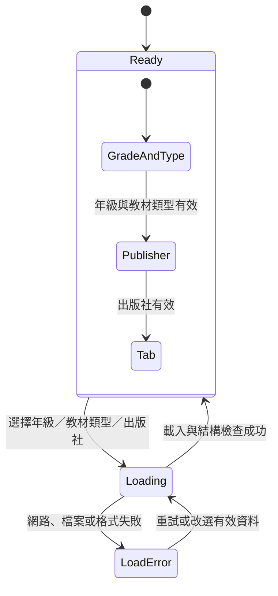
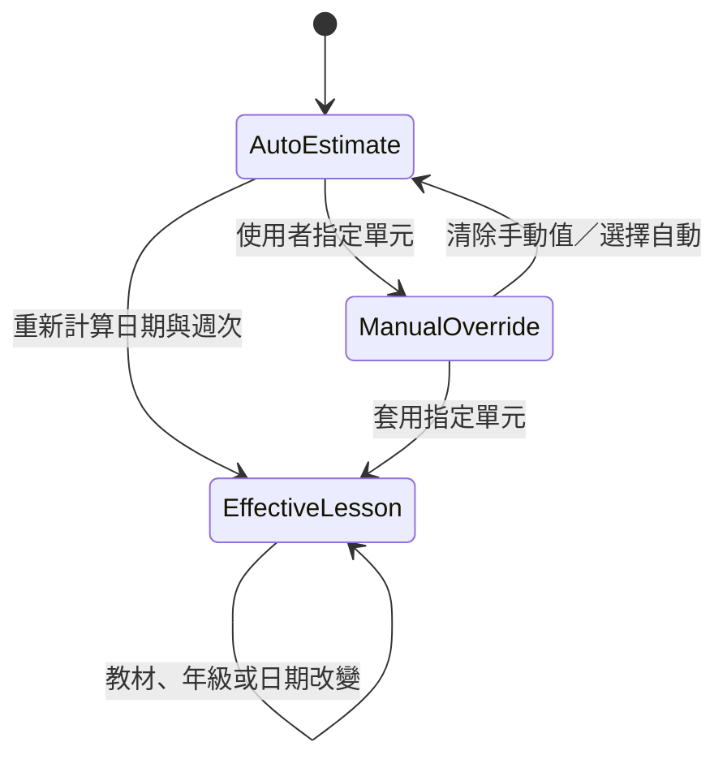
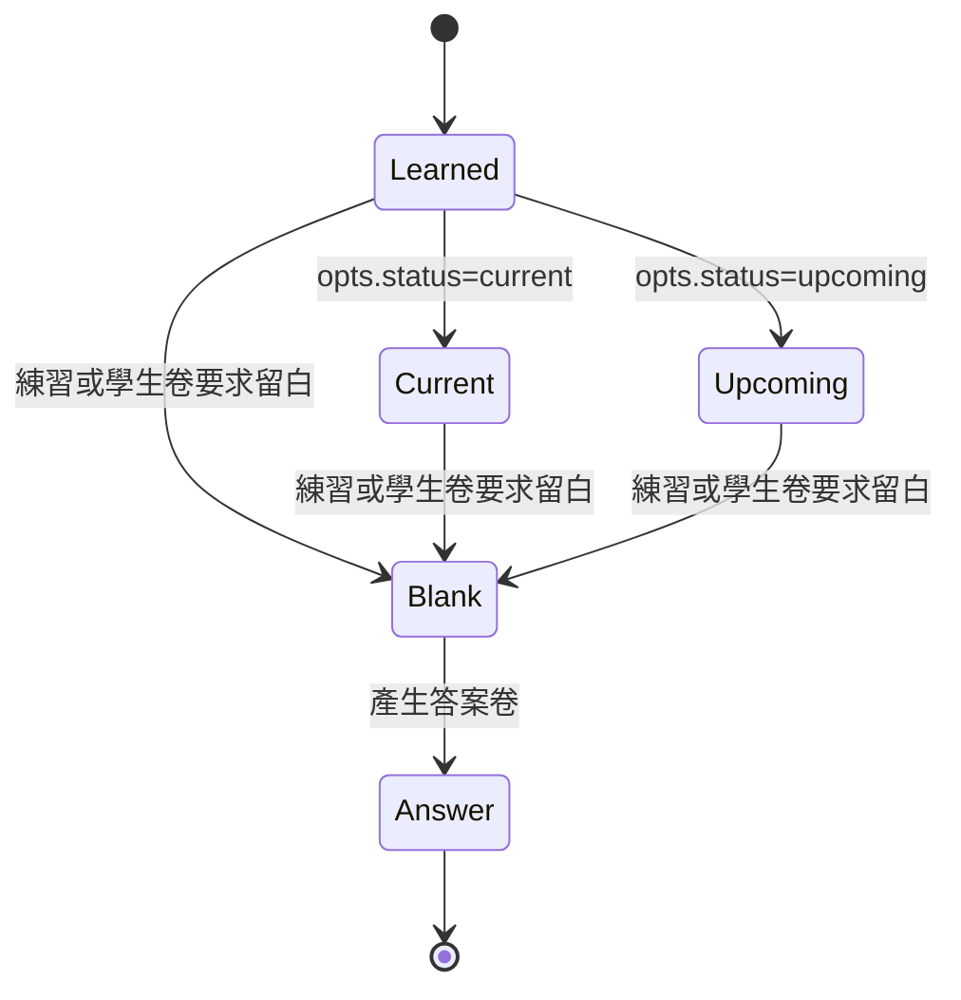
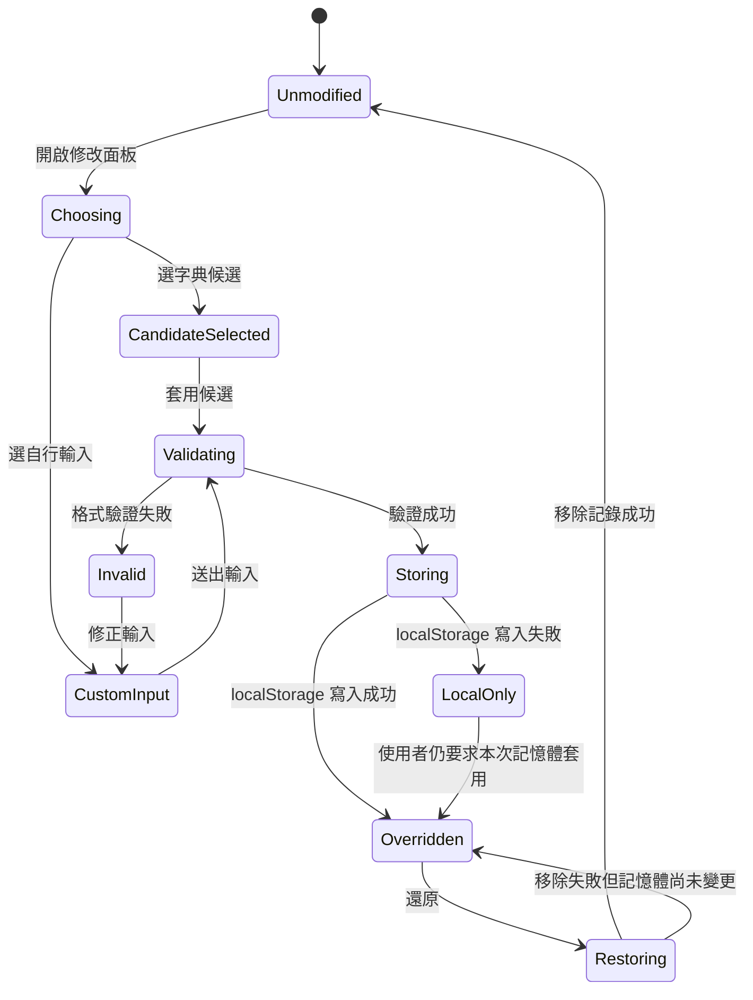
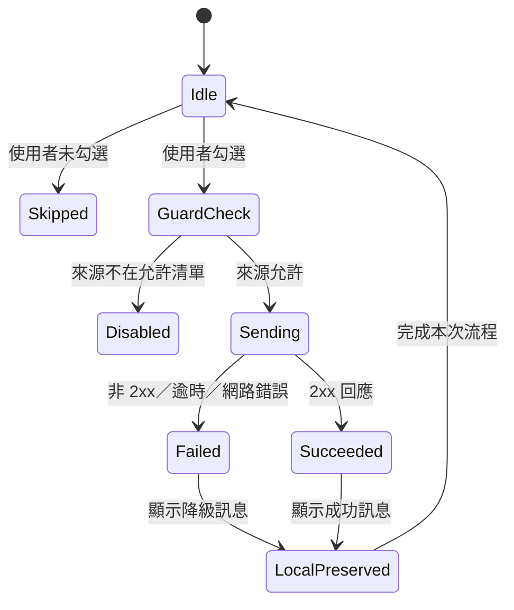
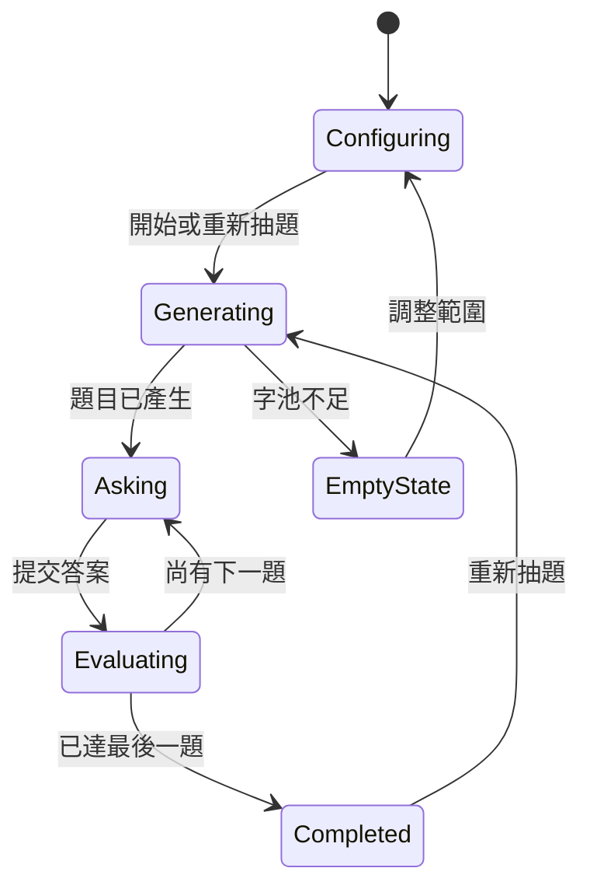
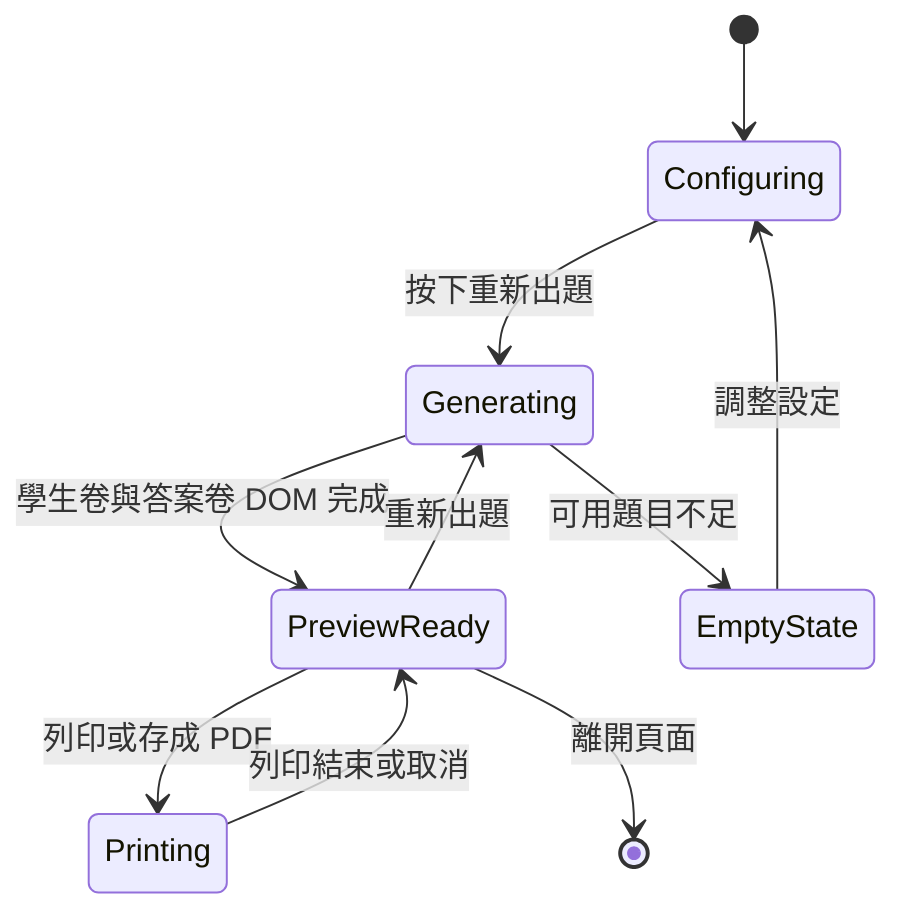
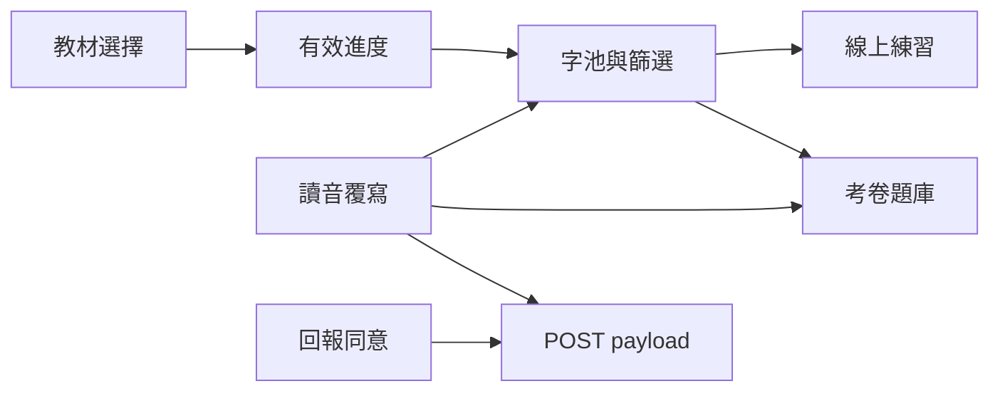

# 字在狀態機與轉換

> 本文件以可觀察的 UI、儲存與產生器行為建模。沒有公開 enum 名稱的內部函式不強行命名；轉換表以狀態與 guard 描述。

## 1. 狀態分類

| 類別 | 狀態保存位置 | 是否持久 | 是否可序列化 |
|---|---|---|---|
| 教材選擇 | 頁面記憶體；部分偏好可回寫 | 部分 | 可，但不應視為教材格式 |
| 載入狀態 | 頁面記憶體 | 否 | 不需要 |
| 學習進度 | `localStorage` | 是 | 邏輯上是；實際 envelope 應另行核對 |
| 讀音覆寫 | `zizai:readingOverrides:v1` | 是 | 是 |
| 練習 | 頁面記憶體與 DOM | 否 | 不需要 |
| 考卷 | 頁面記憶體與 DOM | 否 | 產物可列印成 PDF |
| 回報 | 單次請求狀態 | 否 | payload 僅在送出瞬間存在 |
| 資料建置 | 建置程序 | 否 | 產物為 JSON／HTML／PDF |

## 2. 教材選擇狀態機

### 2.1 初始狀態

- 年級：二年級。
- 教材類型：115 學年度現行資料。
- 出版社版本：預設版本。
- 顯示頁籤：生字進度。

### 2.2 轉換表

| 目前狀態 | 事件／guard | 下一狀態 | 副作用 |
|---|---|---|---|
| `ready` | 選擇年級 | `loading` | 載入該年級的 115 學年度資料 |
| `loading` | 載入成功 | `ready` | 更新單元選單與字卡 |
| `loading` | 載入失敗 | `load-error` | 顯示錯誤；不建立部分教材 |
| `load-error` | 重試或改選其他有效資料 | `loading` | 清除錯誤狀態 |
| `ready` | 在二年級選擇歷史或體驗版 | `loading` | 載入對應變體 |
| `ready` | 在非二年級選擇歷史或體驗版 | `loading` | 自動重設教材類型為 115 學年度後載入 |
| `ready` | 切換出版社版本 | `loading` | 在目前資料集內切換 publisher |
| `ready` | 切換 UI 頁籤 | `ready` | 只改顯示，不改教材資料 |

### 2.3 教材類型 guard

| 年級 | 115-1 | 歷史版 | 體驗版 |
|---|---|---|---|
| 二年級 | 可用 | 可用 | 可用 |
| 一、三至六年級 | 可用 | 不可用；重設 | 不可用；重設 |

出版社可切換不代表每個版本都有相同單元數；前端必須依實際 `lessons` 建立選單，不可寫死固定數量。

## 3. 有效進度狀態機

「自動估算」和「手動覆寫」是互斥的進度來源；最終都轉成一個有效單元。

| 狀態 | 意義 | 結果 |
|---|---|---|
| `auto-estimate` | 沒有有效手動值 | 依學期起點與日期推估目前單元 |
| `manual-override` | 有有效手動值 | 使用者指定值優先 |
| `effective-lesson` | 前端實際採用的單元 | 建立本週目標、已教累計範圍及字卡分類 |

### 3.1 字卡邏輯分類

| 分類 | 來源 | 是否等於持久狀態 |
|---|---|---|
| 本週目標 | 目前有效單元的 `characters` | 否；可由教材與進度重算 |
| 已教累計 | 有效單元之前的單元集合 | 否；可重算 |
| 未來單元 | 有效單元之後的單元集合 | 否；可重算 |
| 已精熟 | 精熟字集合 | 是，屬使用者進度 |
| 待加強 | 不熟字集合 | 是，屬使用者進度 |
| 已修改讀音 | 讀音覆寫 map | 是，屬另一個 localStorage store |

「已精熟」與「待加強」是使用者標記集合；文件不推定兩者必須互斥。畫面篩選器為：

- `all`：全部生字。
- `current`：本週目標字。
- `unfamiliar`：待加強複習。
- `mastered`：已精熟。

## 4. 注音字格顯示狀態

`src/zhuyin.js` 的 `cell`、`word` 與 `sentence` 接受明確的 `opts.status`。這是呈現狀態，不是教材資料狀態。

| 狀態 | 顯示語意 | 備註 |
|---|---|---|
| `learned` | 一般已呈現字格 | 未指定 status 時的預設值 |
| `current` | 本週目標 | 特殊邊框與文字色 |
| `upcoming` | 尚未到達 | 淡化顯示 |
| `blank` | 學生作答留白 | 列印時隱藏答案字 |
| `answer` | 答案卷顯示字 | 使用答案色 |

`mastered` 是可附加在字格上的精熟修飾狀態；它不取代上述 base status。

## 5. 讀音覆寫狀態機

### 5.1 轉換表

| 目前狀態 | 事件 | guard | 下一狀態 | 副作用 |
|---|---|---|---|---|
| `unmodified` | 開啟面板 | 有字 | `choosing` | 顯示字典候選與目前讀音 |
| `choosing` | 選候選或輸入 | 值合法 | `storing` | 立即更新可用畫面 |
| `choosing` | 送出輸入 | 格式不合法 | `invalid` | 顯示欄位錯誤，不寫入 |
| `storing` | `setItem` 成功 | 無 | `overridden` | 卡片、詳情、練習同步套用 |
| `storing` | `setItem` 失敗 | 無 | `local-only` | 顯示需匯出的提示 |
| `overridden` | 還原 | `removeItem` 成功 | `unmodified` | 回到字典讀音 |
| `overridden` | 還原 | `removeItem` 失敗 | `overridden` | 顯示失敗，不宣稱已永久移除 |
| `overridden` | 重新開啟考卷 | 新 DOM 已產生 | `overridden` | 新考卷使用覆寫讀音 |

### 5.2 多音字標註

`ambiguous` 與「是否被使用者覆寫」是正交狀態：

- `ambiguous=true` 可提示主要讀音可能與課本不同。
- 使用者覆寫後，畫面仍可同時顯示原有多音字資訊與「已修改」標記。
- 還原後重新回到字典讀音，不會清除來源資料中的 `ambiguous`。

## 6. 回報狀態機

回報與儲存分離：即使讀音已儲存，未勾選同意仍不得送出。

| 狀態 | 禁止行為 |
|---|---|
| `idle` | 不主動送出任何讀音資料 |
| `skipped` | 不呼叫 `/api/report` |
| `disabled` | 不因來源不允許而改送其他第三方端點 |
| `sending` | 不重複送出同一 payload，避免重複回報 |
| `failed` | 不刪除 `localStorage` 覆寫，不阻斷其他功能 |
| `succeeded` | 不把成功視為教材資料已更新；教材仍需人工審核流程 |

## 7. 線上練習狀態機

練習範圍由可選字池決定：

| 範圍 | 字池 |
|---|---|
| `current` | 目前有效單元的生字 |
| `all-taught` | 已教累計範圍的生字 |
| `unfamiliar` | 待加強字集合 |
| 題數 | 使用者選定的 5、10 或 15；實際不得超過可用字池 |

### 7.1 轉換與副作用

| 事件 | 副作用 |
|---|---|
| 開始抽題 | 從範圍內建立不重複題目集合 |
| 提交答案 | 顯示正確／錯誤回饋；更新本題視覺狀態 |
| 答錯 | 可將目標字納入「待加強複習」集合 |
| 答對 | 是否自動移除待加強標記屬互動政策；資料模型不推定其規則 |
| 重新抽題 | 清除上一輪題目結果，產生新題目 |
| 字池為空 | 不產生空白題目，顯示無可用題目的說明 |

## 8. 考卷與列印狀態機

### 8.1 考卷設定

| 設定 | 型別／值 | 資料流效果 |
|---|---|---|
| 卷首大標題 | string，最多 20 字 | 寫入學生卷與答案卷標題區 |
| 句子填空題數 | integer，輸入範圍 4 至 12 | 不得超過可用句子數 |
| 題目附直排注音 | boolean | 控制注音欄顯示 |
| 姓名欄位 | boolean | 控制卷首欄位 |
| 日期欄位 | boolean | 控制卷首欄位 |
| 得分欄位 | boolean | 控制卷首欄位 |

### 8.2 重要轉換

| 事件／guard | 結果 |
|---|---|
| 資料集沒有 `sentences` | 隱藏整個句子題型，不留下空白大題 |
| 詞語題型存在 | 題號重新由「一、」開始 |
| 覆寫讀音已存在 | 新產生的學生卷與答案卷套用覆寫 |
| 在新分頁開啟考卷 | 重新抽題並重新擷取當時覆寫狀態 |
| 列印媒體 | 隱藏控制介面；學生卷不得顯示答案字 |

## 9. 狀態機之間的資料流

- 教材選擇決定可用的 lesson 與 publisher。
- 有效進度決定「本週」和「已教累計」字池。
- 讀音覆寫只改顯示讀音，不改教材 membership。
- 練習與考卷各自抽題；兩者不必使用相同題目或順序。
- 回報可由讀音覆寫衍生，但必須另經使用者同意。

## 10. 失敗與降級原則

1. 教材資料載入失敗時，不以空資料建立「有效」教材。
2. 單元缺少 `sentences` 時，省略該題型，不建立空題。
3. 讀音覆寫儲存失敗時，不宣稱已永久保存。
4. 回報失敗時，保留本機修改並顯示降級訊息。
5. `localStorage` 內容損壞時，忽略損壞部分，不讓整頁崩潰。
6. 考卷列印失敗不應改變已產生的 DOM 或教材資料。
7. 所有狀態轉換都應避免重複提交、重複回報與重複寫入。
