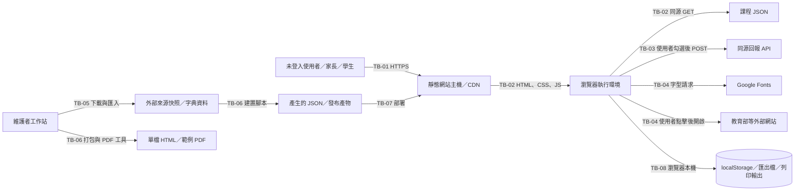

# 字在（zizai-learning）STRIDE 威脅模型

> 文件定位：本文件是針對目前專案架構的增量威脅模型，不重列 `docs/fmb-security/` 已記載的一般性安全控制；各威脅列只保留與攻擊路徑、殘餘風險及修補優先序直接相關的現況與缺口。
>
> 分析基準：目前提供的預設分支內容、`README.md`、`GRADES.md`、`DONE_1151001.md`、前端程式、資料建置工具、打包工具與測試說明。回報 API 的正式服務原始碼、正式部署環境、網域伺服器設定及分支保護設定不在此倉庫中，相關項目均明確標示為「部署待驗」，不以推測代替查核。

## 1. 結論摘要

1. **核心學習功能屬低後端曝險面。** 課程資料、答題與考卷主要由靜態 HTML、CSS、JavaScript 及 JSON 構成，沒有帳號、學生資料庫或付費交易等核心後端。
2. **最高優先風險在選用的回報 API 邊界。** 前端已採取明示選擇、來源網域白名單、相對路徑、失敗降級與欄位驗證，但回報端點的速率限制、內容大小上限、儲存期限、權限隔離與反垃圾機制不在本倉庫，必須視為公開且不可信任的輸入面。
3. **外部匯入資料進入 DOM 的路徑是最高優先的程式碼稽核項目。** 課程標題、字詞、例句、字典內容及使用者備註若有任何未跳脫的 HTML 插入點，可能形成儲存型 DOM XSS；在完成 sink 級稽核前，只能標示為高影響的條件式風險，不能宣稱不存在。
4. **資料建置與發布鏈是教育資料完整性的核心邊界。** 目前已有來源清單、可重跑建置、快照比對與打包斷言，但來源快照簽章、發布物校驗碼、CI 必要檢查及正式部署校驗仍需補齊。
5. **隱私風險集中在自由文字與瀏覽器本機資料。** 讀音修改備註可由使用者自由輸入，回報時可能夾帶個人資訊；進度與修改記錄則存在共用裝置上的殘留風險。核心功能不應蒐集學生姓名或識別資料。
6. **建議順序：**先封住回報 API 的公開輸入面與資料留存，再完成 DOM 跳脫及 CSP 稽核，接著強化建置／發布證據，最後處理第三方字體、本機資料最小化與自動化回歸。

## 2. 範圍、方法與限制

### 2.1 納入範圍

- `index.html` 與 `src/` 下的瀏覽器端程式。
- `data/*.json` 課程資料及其建置流程。
- `tools/build_datasets.py`、`tools/build_grades_from_sources.py` 的資料匯入與產出流程。
- `tools/bundle.py` 的單檔離線產物。
- `tools/make_sample_pdfs.mjs` 的本機 PDF 產生流程。
- `localStorage` 進度與讀音修改儲存。
- 讀音修改的文字／JSON 匯出。
- 使用者主動勾選後的同源回報請求。
- Google Fonts、教育部網站及筆順／辭典服務等第三方流向。
- `tests/test_zizai.js` 已涵蓋的安全相關邏輯。

### 2.2 不在範圍或僅能部分驗證

- 回報 API／Worker 的原始碼、正式環境 WAF、反垃圾規則、資料庫及日誌權限。
- GitHub Pages 或正式網站伺服器的 TLS、安全標頭、快取及部署設定。
- 分支保護、標籤簽章、部署核准及 CI 必要檢查等平台設定。
- 教育部網站、Google Fonts 及字型來源網站本身的內容與可用性。
- 使用者蓄意修改自己的瀏覽器 DOM、JavaScript 或本機狀態；這是純前端系統的固有邊界，不宣稱能以技術完全防止。

### 2.3 安全目標

| 目標 | 說明 |
|---|---|
| SG-01 課程資料完整性 | 生字、讀音、課次、語詞及答案不得因供應鏈或輸入處理錯誤而遭未授權改變。 |
| SG-02 本機學習資料最小化 | 進度、讀音修改及自由文字不得蒐集超出功能所需的個人資料。 |
| SG-03 回報服務隔離 | 匿名回報只能進入受限制的資料收集區，不得直接觸發高權限操作。 |
| SG-04 發布物可追溯 | 每個公開版本應能對應到審查過的來源、建置結果與校驗值。 |
| SG-05 核心服務可用 | 回報、外部字體或外部網站失效時，學習、練習與列印核心功能仍可使用。 |
| SG-06 使用者控制 | 匯出、回報與清除本機資料均須由使用者明示執行，且失敗時不得造成靜默資料遺失。 |

### 2.4 評分準則

**可能性**

| 等級 | 定義 |
|---|---|
| 高 | 普通遠端使用者即可嘗試，或在常見部署情況下容易發生。 |
| 中 | 需要特定設定錯誤、被動資料來源遭改變，或先取得有限 foothold。 |
| 低 | 需要供應鏈高階權限、罕見環境條件或多步驟精準攻擊。 |

**影響**

| 等級 | 定義 |
|---|---|
| 高 | 可能影響大量使用者、公開發布物、廣泛課程資料、敏感自由文字或隱私。 |
| 中 | 主要影響單一使用者、單一功能、回報佇列或部分部署流程。 |
| 低 | 僅造成局部功能受限、畫面品質下降或可快速恢復的單機問題。 |

**修補優先序**

| 優先序 | 時程定義 |
|---|---|
| P0 | 下一次公開部署前完成；若無法確認回報 API 的保護狀態，採保守停用或隔離。 |
| P1 | 下一個正式開發循環內完成。 |
| P2 | 未來一至兩個循環完成。 |
| P3 | 持續性改善或接受風險後定期檢視。 |

## 3. 系統架構與信任邊界



### 3.1 元件與信任關係

| 元件 | 信任程度 | 說明 |
|---|---|---|
| 瀏覽器中的應用程式 | 低信任執行環境 | 與同源其他程式共用瀏覽器權限；瀏覽器擴充套件或被注入的同源腳本可能讀取本機狀態。 |
| 課程 JSON | 完整性關鍵 | 內容在發布時決定，但多數欄位源自外部來源；發布後屬靜態資料。 |
| `localStorage` | 本機、未加密 | 可被同源程式讀寫；瀏覽器擴充套件、使用者或受控裝置攻擊者可存取。 |
| 回報 API | 獨立高風險邊界 | 在本倉庫外；必須視為公開、匿名且不可信。 |
| 靜態網站主機 | 高價值控制點 | 主機、網域或部署帳號遭控制時，可對所有使用者供應惡意程式。 |
| 外部來源快照 | 未簽章輸入 | 供建置脚本讀取；目前由 `.gitignore` 排除原始快照。 |
| 建置／發布工作站 | 高權限控制點 | 可讀取來源、產生正式資料與發布物；其環境與工具鏈屬敏感資產。 |
| 第三方網站 | 外部控制 | 網站可用性、內容與追蹤行為不由本專案控制。 |

### 3.2 信任邊界

| 邊界 | 跨越方向 | 主要風險 | 必要控制 |
|---|---|---|---|
| TB-01 | 公開網路 → 靜態主機 | 服務中斷、網域或快取遭控制 | TLS、部署變更管制、內容稽核、復原點 |
| TB-02 | 靜態主機 → 瀏覽器 | 惡意 JavaScript／JSON 被當成可信程式執行 | 受保護發布、完整性驗證、CSP、變更監控 |
| TB-03 | 瀏覽器 → 回報 API | 偽造來源、垃圾回報、任意輸入、資料留存 | 嚴格 schema、大小上限、速率限制、隔離與期限 |
| TB-04 | 瀏覽器 → 第三方 | 連線資料外洩、第三方內容或字型供應鏈遭控制 | 最小化第三方、自行託管或移除、`no-referrer` |
| TB-05 | 外部來源 → 維護者工作站 | 被竄改的 CSV／字典進入正式資料 | 來源固定、雜湊、簽章來源清單、人工覆核 |
| TB-06 | 來源與工具 → 建置產物 | 建置工具、輸入或環境遭控制 | 最小權限、固定工具版本、乾淨建置、事後比對 |
| TB-07 | 發布物 → 正式主機 | 未審查產物、版本錯置、快取污染 | 核准、發布校驗碼、可追溯版本、原子部署 |
| TB-08 | 瀏覽器 → 本機儲存／檔案／印表機 | 共用裝置殘留、使用者誤分享 | 資料最小化、明確匯出、清除功能、分享提醒 |
| TB-09 | 回報 API → 維運／審查人員 | 自由文字中的個人資訊與不當存取 | 最小權限、禁止正文進一般日誌、期限刪除、審核紀錄 |

## 4. 資產登錄

| 資產 | 內容 | 主要安全屬性 | 建議分級 |
|---|---|---|---|
| A-01 課程資料 | 生字、課次、讀音、語詞、例句、答案與來源資訊 | 完整性、可用性 | 高 |
| A-02 讀音修改 | 使用者選取的讀音、備註、課次、時間等本機資料 | 完整性、機密性 | 中；可推知學習活動 |
| A-03 學習進度 | 已教、精熟、不熟與手動進度 | 完整性、機密性 | 中；不應視為無個資 |
| A-04 回報資料 | 自由文字備註、頁面與視窗資訊、來源網域等 | 機密性、完整性、可用性 | 高（自由文字可能含個資） |
| A-05 回報 API 容量與名譽 | 請求配額、處理佇列、封鎖與錯誤率 | 可用性、完整性 | 高 |
| A-06 靜態網站 | HTML、CSS、JavaScript、JSON 與快取 | 完整性、可用性 | 高 |
| A-07 發布與建置鏈 | 來源快照、建置結果、工具版本、部署紀錄 | 完整性、可追溯性 | 高 |
| A-08 使用者匯出與列印輸出 | 文字／JSON 匯出、學生卷與答案卷 | 完整性、機密性 | 中 |
| A-09 瀏覽器本機狀態 | `localStorage` 內的進度及修改資料 | 機密性、完整性 | 中 |
| A-10 第三方請求資料 | IP、User-Agent、Referer、頁面來源及可能的字型請求資訊 | 機密性 | 低至中 |
| A-11 授權與來源憑證 | 來源網址、授權說明、版本與校驗資訊 | 完整性、合規性 | 高 |
| A-12 維運紀錄 | 回報審查、錯誤與告警紀錄 | 完整性、機密性 | 中至高 |

## 5. 資料流

| 資料流 | 來源 → 目的 | 資料 | 傳輸／控制 | 主要威脅 |
|---|---|---|---|---|
| DF-01 | 靜態主機 → 瀏覽器 | HTML、CSS、JavaScript | HTTPS；正式環境設定待驗 | S-02、T-02、D-03 |
| DF-02 | 靜態主機 → 瀏覽器 | 課程 JSON | 同源 `fetch`；資料檔完整性取決於發布 | T-01、T-02、D-03 |
| DF-03 | Google Fonts → 瀏覽器 | 字型 CSS 與字型檔 | 公開版自動連線；離線版移除；失敗有系統字型備援 | I-03、D-05 |
| DF-04 | 瀏覽器 → 教育部等網站 | 使用者選取查詢的字 | 使用者點擊才開啟；目的地不在本專案控制 | S-03、I-03 |
| DF-05 | 瀏覽器 → 回報 API | 應用程式種類、事件種類、自由文字備註、頁面／視窗資訊及蜜罐欄位 | 使用者勾選、同源相對路徑、網域白名單、10 秒逾時、失敗降級 | S-01、T-05、I-02、E-01、D-01 |
| DF-06 | 瀏覽器 → `localStorage` | 進度、讀音修改、版本欄位 | 命名空間鍵；讀寫例外處理；無伺服器身分驗證 | S-04、T-04、I-01 |
| DF-07 | 瀏覽器 → 剪貼簿／使用者選定檔案／印表機 | 修改文字、JSON、考卷 | 使用者主動執行；離開瀏覽器後不受本專案控制 | I-04 |
| DF-08 | 外部來源 → 維護者工作站 | 生字清單快照、字典資料 | 原始快照被 `.gitignore` 排除；來源需另行下載 | T-01、I-05 |
| DF-09 | 建置腳本 → `data/*.json` | 正規化課程 JSON | 可重跑、斷言替換、資料測試 | T-01、T-05、E-04 |
| DF-10 | HTML/CSS/JS/JSON → 單檔 HTML | 全部靜態資產 | 打包替換必須恰好命中一次；離線產物檢查外部資源 | T-02、R-03 |
| DF-11 | 打包頁面 → 本機 PDF 工具 | 考卷 DOM 與輸出 PDF | 僅本機隨機埠、暫存瀏覽器設定；輸出可指定路徑 | T-06、D-06 |
| DF-12 | 回報 API → 維運審查環境 | 匿名回報與網路層中繼資料 | API 內部權限與留存設定不在本倉庫 | R-02、I-02、I-05 |

## 6. STRIDE 威脅分析

### 6.1 Spoofing（身分偽冒）

| ID | 威脅情境與攻擊路徑 | 可能性 | 影響 | 現有緩解 | 缺口與建議 | 優先序 |
|---|---|---:|---:|---|---|---:|
| S-01 | 匿名使用者繞過前端，直接呼叫 `/api/report`。非瀏覽器客戶端可省略或偽造 Origin／Referer；若服務端把來源標頭當成身分，即能提交假回報、灌入內容或消耗處理容量。 | 高 | 中；若回報可觸發其他操作則為高 | 前端僅在使用者勾選後送件；採網域白名單與同源相對路徑；既有測試涵蓋 payload 驗證與多種錯誤回應。 | 來源標頭不是身分證明。正式服務須以嚴格 schema、大小上限、速率／配額、重複內容偵測及隔離佇列處理；不得因來源檢查失敗而執行高權限動作。 | P0 |
| S-02 | 網域、部署帳號、靜態主機或 CDN 快取遭控制，對外供應攻擊者版本的 HTML／JavaScript。使用者無法從頁面外觀辨識。 | 中 | 高 | 正式發布預設使用 HTTPS；打包器對替換位置、網路呼叫與外部資源有強斷言。 | 倉庫內容未顯示發布簽章、部署校驗值、變更監控或回復至已知良好版本的機制。應以受保護發布、CI 必要檢查、部署校驗碼及定期內容比對降低風險。 | P0 |
| S-03 | 教育部等外部連結遭網域接管、重新導向或內容遭替換，使用者誤把第三方頁面當成官方資料。 | 低 | 中 | 查詢目的地使用固定官方網域；連結由使用者主動點擊，不自動帶入課程資料。 | 外部頁面內容不在本專案控制；應保留明確的外部連結文字，避免只顯示字卡，並評估 `noopener`、`noreferrer` 與前往外部網站前的提示。 | P2 |
| S-04 | 共用裝置上的另一使用者或瀏覽器擴充套件冒充原使用者，修改或讀取本機進度與讀音設定。 | 中 | 中 | 本機狀態採具名鍵；讀音格式與欄位有驗證；讀寫失敗不會使頁面崩潰。 | 本機狀態沒有身分驗證，也無法證明由原使用者設定。核心資料應保持非敏感；必要時提供清除入口，並明確告知共用裝置風險。 | P1 |

### 6.2 Tampering（資料竄改）

| ID | 威脅情境與攻擊路徑 | 可能性 | 影響 | 現有緩解 | 缺口與建議 | 優先序 |
|---|---|---:|---:|---|---|---:|
| T-01 | 外部 CSV 或字典來源遭替換，內容經建置腳本寫入正式 JSON；教材、讀音或例句被系統性改變。 | 中 | 高 | 原始快照不進版本庫；資料來源與授權有文件；生成流程可重跑；來源快照逐課比對及資料結構測試已存在。 | 測試只證明「目前快照」與 JSON 一致，若來源與輸出同時遭改，仍可能一致。應保存來源快照校驗值、來源版本與建置時間，並對來源變更要求人工覆核。 | P0 |
| T-02 | 靜態主機、部署流程或快取遭修改，瀏覽器取得不同於已審查版本的程式或 JSON。 | 低至中 | 高 | HTTPS 可防止一般傳輸攔截；離線打包檔禁止殘留外部 script；打包斷言可降低產物誤製機率。 | 未見簽章發布、部署前／後校驗、SRI 適用性評估或變更告警。對同源 JSON 可使用簽章 manifest；對靜態程式則採發布校驗與受保護部署。 | P0 |
| T-03 | 外部來源中的標題、字典內容、例句、網址或使用者自由文字進入 DOM；若任何渲染點以未跳脫的 HTML 插入，可能執行攻擊者控制的程式，竄改畫面或讀取本機資料。 | 中（取決於 sink 稽核） | 高 | 資料欄位多為受限結構；注音輸入與備註長度有前端驗證；本機資料讀寫有例外處理。 | 目前可見說明沒有證明所有渲染點均採 context-aware encoding，也沒有安全標頭與惡意內容回歸測試。應逐一稽核 `innerHTML`、模板與 URL 屬性，未信任值一律以文字節點輸出；必要時採嚴格允許清單清理器。 | P0 |
| T-04 | 使用者、擴充套件或同源 XSS 修改 `localStorage`，改變已教進度、精熟狀態或讀音修改，進而影響練習與考卷。 | 高（裝置持有者）；中（受攻擊同源程式） | 中 | 儲存讀寫採 try／catch；讀音格式與部分資料範圍有驗證；版本遷移與損壞資料已有測試。 | 本機資料沒有完整性標記，使用者可回捲或刪除。應維持「本機狀態非權威資料」的產品假設，所有顯示與出題前重新檢查範圍，不把本機標記當成認證或伺服器事實。 | P1 |
| T-05 | 回報內容在 API、佇列或審查工具中被改寫，維護者看到與使用者原意不同的內容，進而錯誤更新課程資料。 | 中 | 中 | 前端 payload 固定欄位；API 文件記載有欄位驗證；錯誤回應不影響核心功能。 | 未見 API 端不可變事件紀錄、內容雜湊、審核簽署或從回報到資料變更的追溯鏈。應保存最小必要事件、不可變時間戳與處理狀態；任何資料更新仍需獨立人工審核。 | P1 |
| T-06 | PDF 產生後被替換，或範例 PDF 與目前程式版本不一致，維護者或使用者誤用錯誤教材。 | 低 | 中 | PDF 工具由同一份 DOM 同時產生學生卷與答案卷；Chrome 使用暫存設定；工具僅服務本機隨機埠。 | 產物沒有版本、來源 commit、校驗值或簽章資訊。應在產物中記錄版本與產生日期，並發布校驗清單。 | P2 |

### 6.3 Repudiation（否認／不可追溯）

| ID | 威脅情境與攻擊路徑 | 可能性 | 影響 | 現有緩解 | 缺口與建議 | 優先序 |
|---|---|---:|---:|---|---|---:|
| R-01 | 使用者修改、清除或匯出本機進度後，否認曾設定某項狀態；系統沒有可信紀錄。 | 高 | 低至中 | 可主動匯出文字／JSON；資料儲存在瀏覽器本機。 | 純前端無法提供不可竄改稽核軌跡。應明文承認此限制，不將本機進度當成正式學習紀錄；需要跨裝置紀錄時另設計有明確同意的服務。 | P1 |
| R-02 | API 回報遺失、重複或處理狀態不明，維護者與使用者對「是否已收到」有爭議。 | 中 | 中 | 前端顯示成功／失敗並處理逾時；API 回應格式可測試。 | 未見可交給使用者的收據識別碼、伺服器時間、重送冪等鍵或處理紀錄。應回傳不含個資的收據號，允許安全重試，並記錄去重與審核狀態。 | P1 |
| R-03 | 公開版本無法證明由哪份來源、工具及審查流程產生，發生錯誤時難以界定影響範圍。 | 低至中 | 高 | Git 歷史、來源文件與打包斷言提供部分追溯。 | 未見正式發布簽章、artifact manifest、校驗值保存處及「輸入 → 產生 → 部署」關聯。應建立每次發布的來源與產物校驗清單。 | P0 |
| R-04 | 使用者回報讀音差異後，官方資料被修改，但無法追溯是誰提出、何時審核或依何版本修正。 | 中 | 中 | 回報可附閱讀脈絡；讀音修改匯出保留課程脈絡欄位；官方資料更新有既有多輪紀錄。 | 匿名回報沒有可驗證身分，也未見從回報到資料合併的簽核紀錄。應保留來源版本、審核者決策與變更差異；不可把回報視為自動授權。 | P1 |

### 6.4 Information Disclosure（資訊揭露）

| ID | 威脅情境與攻擊路徑 | 可能性 | 影響 | 現有緩解 | 缺口與建議 | 優先序 |
|---|---|---:|---:|---|---|---:|
| I-01 | 共用電腦上的下一位使用者開啟同一網域，即可讀取前一位的進度與讀音修改；讀音備註可能含個人資訊。 | 中 | 中 | 核心狀態採具名鍵；資料不會自動回報；使用者可自行匯出。 | 本機狀態未加密、無使用者鎖定，也無自動清除。若資料可能含敏感內容，應減少自由文字、明確提示共用裝置風險並提供一鍵清除。 | P1 |
| I-02 | 使用者在回報備註中輸入姓名、聯絡方式或其他個人資訊，資料進入回報 API、備份或維運日誌。 | 中 | 高 | 回報預設不勾選；前端限制備註長度；正式環境僅特定網域可送；未勾選不會送出。 | 「短」不等於「無個資」。應在送出前明確告知可能含個資與保存方式；伺服器端最小化、限制存取、禁止正文進入一般日誌，並採短期留存。 | P0 |
| I-03 | 公開版自動向第三方字型服務發出 IP、User-Agent 與 Referer；前往教育部查詢時也可能暴露來源頁資訊。 | 高 | 低至中 | 字型失敗有系統字型備援；離線版無外部字型請求；教育部連結需使用者點擊。 | 未見 `Referrer-Policy`、字型自託管或全面移除第三方字型的決策。預設以系統字型或合法自託管字型取代；跨網站連結採最小 Referer。 | P1 |
| I-04 | 使用者將修改 JSON、文字或考卷分享給他人；分享管道不受本專案控制，檔案內容可能被誤當成正式資料。 | 中 | 中 | 匯出與列印皆由使用者主動執行；一般不會自動上傳。 | 未見分享提醒、正式／個人資料標示或移除自由文字的匯出選項。應在匯出與列印介面說明用途，並提供不含備註的選項。 | P2 |
| I-05 | 回報 API 或反向代理的網路日誌保存 IP、User-Agent、時間與路徑；存取或保存期間超出需求。 | 中 | 中 | 前端 payload 未預設包含帳號身分；核心功能不依賴後端。 | 網路層紀錄政策不在本倉庫。應將其視為個人資料，限制保存期與存取，與回報正文分離保存。 | P1 |

### 6.5 Elevation of Privilege（權限提升）

| ID | 威脅情境與攻擊路徑 | 可能性 | 影響 | 現有緩解 | 缺口與建議 | 優先序 |
|---|---|---:|---:|---|---|---:|
| E-01 | 公開、匿名的回報欄位若在後端被當成可信命令、模板、查詢或觸發器，可能跨越資料收集與高權限操作邊界。 | 中 | 高 | 前端欄位與 payload 經測試；錯誤輸入有驗證；回報功能不與核心學習資料寫入共用路徑。 | 後端原始碼不可見，不能確認隔離、模板逸出防護、查詢參數化、least privilege 或網路出口限制。應以不可信輸入設計回報端點，禁止內容評估與任意外部請求。 | P0 |
| E-02 | 具備網站 origin 的惡意頁面誘導瀏覽器對同源 API 發出狀態變更請求，形成 CSRF。 | 低至中 | 中；目前若為唯讀／附加回報則偏低 | 回報使用同源相對路徑；前端主動送出；預期不依賴 cookie 身分。 | 未見 CSRF token 與 Content-Type／Origin 強制檢查。若 API 未來綁定帳號或改為狀態變更，必須加入 CSRF 、防重放與明確授權；目前應維持匿名附加資料的最小權限。 | P1 |
| E-03 | 惡意瀏覽器擴充套件、遭控制的同源程式或受感染裝置讀取本機資料並直接呼叫 API；前端「使用者勾選」無法約束非頁面程式。 | 中 | 中至高 | 回報 payload 不預設含帳號；核心無帳號與高權限操作；本機資料範圍有限。 | 同源 JavaScript 與擴充套件的讀取能力無法由本頁完全阻止。應減少敏感資料與回報正文，並讓後端不把瀏覽器環境當成可信證據。 | P1 |
| E-04 | 維護者工作站、建置工具或發布權限遭控制，攻擊者可將未審查資料與程式送入公開環境。 | 中 | 高 | 工具多使用標準函式庫；打包替換有嚴格斷言；資料與來源測試完整；原始大型來源快照未收入倉庫。 | 未見 CI 最小權限、工具版本固定、發布簽章及受保護分支的倉庫內證據。應把發布權限視同高權限資產，採核准、隔離建置及簽章校驗。 | P0 |

### 6.6 Denial of Service（服務拒絕）

| ID | 威脅情境與攻擊路徑 | 可能性 | 影響 | 現有緩解 | 缺口與建議 | 優先序 |
|---|---|---:|---:|---|---|---:|
| D-01 | 大量直接呼叫回報 API，造成成本上升、雜訊過多、正常回報被淹沒或服務被暫時封鎖。 | 高 | 中至高 | 前端逾時與失敗不影響核心學習；已有 429 等失敗路徑處理。 | 處理 429 不等於伺服器真的有速率限制。應在邊緣與應用層設匿名配額、突發流量限制、去重與人工隔離佇列。 | P0 |
| D-02 | 惡意客戶端送出超大、深度過高或格式異常的 JSON，佔用 API 解析資源。 | 中 | 中 | 正常前端備註長度有限；預期只接受固定欄位。 | 前端限制可被直接呼叫者繞過。應在反向代理與 API 同時限制 body bytes、內容型別、欄位數量、字串長度及解析時間。 | P0 |
| D-03 | 靜態主機、CDN 或某一年級 JSON 無法取得，造成全站或單一年級功能失效。 | 低至中 | 中至取決於範圍 | 核心為靜態內容；不同年級資料按需載入；字型失敗有備援。 | 未見已知良好版本回復、快取失效監控、部署前完整性檢查或資料 manifest。應使用可回復部署、版本化資料與線上健康檢查。 | P1 |
| D-04 | `localStorage` 容量已滿、內容損壞或版本過舊，造成啟動失敗或重複寫入。 | 中 | 低至中 | 讀寫採 try／catch；損壞資料有測試；部分流程可降級。 | 仍可能反覆寫入造成額外負擔，且使用者不易察覺資料未保存。應限制項目數與大小、使用單次合併寫入，並在降級時提示使用者匯出。 | P2 |
| D-05 | 第三方字型服務緩慢或失效，讓公開版首次載入延遲。 | 中 | 低 | 字型失敗採系統字型；單檔離線版完全不依賴字型服務。 | CSS 仍可能等待字型下載。預設移除自動第三方字型請求或改自託管，可直接降低此風險。 | P1 |
| D-06 | 本機 PDF 工具遇到無 Chrome、頁面未就緒或異常輸出，造成資源殘留或無效範例檔。 | 低 | 低 | 僅在本機執行；使用暫存瀏覽器設定、有限等待並清理；只服務專案路徑。 | 未見明確的 CPU／記憶體上限、輸出檔先寫暫存再驗證及失敗重試。應在本機測試流程加入逾時、資源上限及原子輸出。 | P3 |

## 7. 優先威脅情境展開

### AP-01：匿名回報端點遭灌入與資源消耗

- **前置條件：**知道或猜測公開 API 路徑；不需瀏覽器使用者權限。
- **攻擊路徑：**直接建立大量請求 → 繞過前端白名單與勾選邏輯 → 填入合法 schema 但具重複性或高頻內容 → 佔用解析、儲存、寄送或人工審查資源。
- **既有控制：**前端不自動回報、來源白名單、失敗降級、欄位驗證。
- **主要缺口：**伺服器端配額、大小上限、留存、冪等與人工隔離未能從本倉庫確認。
- **目標狀態：**伺服器在不使用瀏覽器標頭作身分證明的情況下，仍能安全、有限額地處理所有輸入，且不影響核心網站。

### AP-02：外部來源遭改寫後進入課程資料與 DOM

- **前置條件：**外部來源帳號、建置工作站或發布流程任一處遭控制。
- **攻擊路徑：**替換來源欄位 → 重跑建置 → 產生看似通過結構測試的 JSON → 不安全 DOM 渲染執行惡意內容或直接顯示錯誤教材。
- **既有控制：**來源不在版本庫、結構測試、快照逐課比對、打包斷言。
- **主要缺口：**來源校驗碼、來源變更人工核准、DOM sink 逐項跳脫與 CSP。
- **目標狀態：**任何來源變更都可被獨立辨識；所有非信任值在輸出時保持資料而非程式。

### AP-03：回報自由文字帶入個人資訊

- **前置條件：**使用者誤將姓名、聯絡方式或其他識別資訊放入備註並勾選回報。
- **攻擊路徑：**自由文字 → API 儲存 → 可能進入快取、備份、錯誤通知或人工檢視信箱 → 超出教育回報目的存取。
- **既有控制：**需明示勾選、備註長度有限、特定網域才送。
- **主要缺口：**送出前隱私告知、正文與網路日誌分離、保存期限與刪除程序。
- **目標狀態：**即使使用者誤填，回報系統也不在一般日誌、備份或長期儲存中擴散該內容。

### AP-04：靜態發布帳號遭控制

- **前置條件：**取得網域、部署或 CDN 控制權。
- **攻擊路徑：**發布惡意 JavaScript → 所有訪客執行 → 讀取同源本機狀態、偽造畫面、竊取使用者主動輸入或把資料送往攻擊者端點。
- **既有控制：**HTTPS、打包時網路面檢查、離線版無外部 script。
- **主要缺口：**部署簽章、變更核准、發布後校驗、告警及回復機制。
- **目標狀態：**發布權限受到強隔離，所有公開版本均可與核准的校驗值對應。

### AP-05：共用裝置殘留學習資料

- **前置條件：**多人共用電腦或家長／學生共用同一瀏覽器設定檔。
- **攻擊路徑：**前一位使用者保存讀音修改或自由文字備註 → 下一位使用者開啟頁面 → 讀取或誤用既有狀態。
- **既有控制：**資料只留本機、不自動上傳、具名鍵及格式驗證。
- **主要缺口：**清除入口、敏感自由文字最小化、共用裝置提示。
- **目標狀態：**不讓無關使用者誤以為資料屬於自己，並讓資料可輕易且完整清除。

## 8. 跨情境殘餘缺口索引

| 缺口主題 | 關聯威脅 | 為何重要 |
|---|---|---|
| 回報 API 的伺服器端保護不可由本倉庫驗證 | S-01、T-05、E-01、D-01、D-02、I-02 | 是目前最直接、一般的遠端攻擊面。 |
| DOM 跳脫與安全標頭缺乏完整證據 | T-03、E-03 | 一旦存在未跳脫 sink，影響會由單一使用者擴大至同源整體。 |
| 來源、產物與部署缺少端到端校驗鏈 | T-01、T-02、R-03、E-04 | 決定教育資料與公開程式能否被可信追溯。 |
| 自由文字與本機狀態的最小化不足 | I-01、I-02、I-04 | 即使沒有帳號，學習活動與誤填內容仍可能屬個人資料。 |
| 第三方字型與 Referer 暴露未完全排除 | I-03、D-05 | 可在不依賴帳號的情況下降低資料暴露並改善可用性。 |
| 正式部署安全設定不可見 | S-02、T-02、D-03 | HTTPS 以外的安全標頭與快取策略會直接影響實際風險。 |

## 9. 建議修補優先順序

### 9.1 P0：下一次公開部署前

| 動作 ID | 建議動作 | 對應威脅 | 驗收條件 |
|---|---|---|---|
| P0-01 | 將回報 API 視為公開匿名入口：嚴格 schema、body bytes 上限、Content-Type 檢查、速率／配額、重複偵測、人工隔離佇列、禁止高權限副作用。 | S-01、E-01、D-01、D-02 | 僅以本機假 API 測試：格式錯誤、過大內容、重複內容與突發流量均被拒絕或隔離；核心學習頁不受影響。 |
| P0-02 | 完成所有 DOM 輸出點稽核；未信任資料以文字節點或安全 API 輸出，URL 欄位採允許清單；補上惡意標記回歸測試。 | T-03、E-03 | 匯入的標題、例句、字典欄位、備註與網址均以文字顯示，不會形成可執行標記或非允許網址。 |
| P0-03 | 修正回報隱私：送出前提示可能含個資、禁止正文進一般日誌、限制原始內容保存期、限定維運存取並建立刪除程序。 | I-02、I-05、R-02 | 從網路層日誌、應用程式日誌與回報儲存區分別抽查，均無不必要正文副本；到期可刪除。 |
| P0-04 | 建立發布防線：受保護分支、CI 必要檢查、輸入與產物差異檢查、產物校驗清單、核准部署及已知良好版本回復程序。 | T-01、T-02、R-03、E-04 | 每次公開版本均能列出來源、工具版本、產生時間、產物校驗值與核准狀態；還原測試可回復上一良好版本。 |
| P0-05 | 盤點正式部署安全標頭；先以觀察模式驗證 CSP，再逐步禁止 inline 程式與非必要外部來源；至少落實 `object-src 'none'`、`base-uri 'none'`、`frame-ancestors 'none'`、HSTS 與適當 Referer 政策。 | S-02、T-02、T-03、E-03 | 正式頁面不回報未核准的 script、frame 或外部連線；CSP 觀察報告無未核准來源後再強制執行。離線單檔需使用適合其內嵌結構的相容政策。 |

### 9.2 P1：下一個正式開發循環

| 動作 ID | 建議動作 | 對應威脅 | 驗收條件 |
|---|---|---|---|
| P1-01 | 為來源快照與生成資料建立版本化 manifest，記錄來源、取得時間、工具版本及 SHA-256 校驗值；來源變更需人工核准。 | T-01、R-03 | 相同來源可重建相同資料；來源或工具改變時必須留下核准紀錄。 |
| P1-02 | 預設改用系統字型；如需自託管字型，先確認授權，再移除公開版對第三方字型服務的自動請求。 | I-03、D-05 | 公開頁面不向未核准第三方主機提出字型請求，載入失敗仍可正常排版。 |
| P1-03 | 本機資料最小化：減少自由文字敏感度、限制保存項目、顯示「本機儲存」狀態、提供一鍵清除與不含備註的匯出選項。 | S-04、T-04、I-01、I-04 | 清除後重新載入無殘留；匯出選項可排除自由文字；共用裝置提示明確。 |
| P1-04 | 回報 API 提供不含個資的收據號、去重鍵、處理狀態與安全重試；內容更新仍需獨立人工審核。 | R-02、R-04、T-05 | 使用者可確認是否被接收；同一事件重送不重複佔用資源；回報不直接變更正式資料。 |
| P1-05 | 對外部連結補齊安全的 opener／referrer 屬性與明確的外部連結文字；對同源 API 檢查來源與內容型別，未來若加入帳號狀態再採 CSRF token。 | S-03、E-02、I-03 | 新視窗無法取得來源頁 opener；跨網址請求不攜帶不必要 Referer；狀態型 API 拒絕跨站請求。 |
| P1-06 | 建立固定工具版本、乾淨建置環境及產物比較流程；避免建置工作階段具有不必要的部署權限。 | T-01、T-05、E-04 | 正式建置可由最小權限身分完成；工具版本變更會留下可見差異。 |

### 9.3 P2：未來一至兩個循環

| 動作 ID | 建議動作 | 對應威脅 | 驗收條件 |
|---|---|---|---|
| P2-01 | 在本機假服務執行容量與故障測試，涵蓋逾時、重複、過大內容、暫時錯誤及冷啟動；不得對正式服務進行壓測。 | D-01、D-02、D-03 | 測試只使用 `127.0.0.1` 的暫存服務；失敗不影響核心功能，且有明確降級訊息。 |
| P2-02 | 增加靜態安全檢查：未跳脫 DOM sink、未核准外部來源、秘密樣式、危險檔案權限及發布產物校驗。 | T-02、T-03、S-02 | 檢查在 CI 中阻擋不合規產物；掃描結果不包含任何秘密值。 |
| P2-03 | 對字型、字型 CSS、公開依賴與外部服務狀態建立維運檢視；只記錄必要狀態，不保存自由文字正文。 | D-03、D-05、I-05 | 告警不包含回報正文或個人資料；可快速切換至系統字型或已知良好版本。 |
| P2-04 | 每季或每次資料管線重大變更後重看本文件，更新威脅情境、部署邊界與緩解證據。 | 全域 | 文件有版本日期、負責複核紀錄與新增威脅的處置結果。 |

### 9.4 P3：持續性改善

| 動作 ID | 建議動作 | 對應威脅 | 驗收條件 |
|---|---|---|---|
| P3-01 | 評估對公開發布物提供簽章 manifest 與可重現建置證明；簽章作業不得在本專案內保存私密材料。 | S-02、R-03 | 驗證工具可辨識被竄改產物，且一般建置環境不持有發布權限。 |
| P3-02 | 若未來需要跨裝置學習紀錄，另行建立具明確同意、最小蒐集、可匯出／刪除的獨立服務；不得直接把現有匿名回報擴成學生帳號系統。 | E-01、E-02、I-01 | 新服務有獨立資料流程、權限模型、隱私告知與威脅分析。 |

## 10. 驗證與測試計畫

所有安全測試應在本機或隔離環境執行，不得連線至正式服務，也不得使用真實使用者資料。

### 10.1 既有回歸

```text
node tests/test_zizai.js
```

- 預期在具備完整本地來源快照與字典時：87 項通過、0 項失敗。
- 若依 README 所述未具備來源快照：預期 66 項通過、21 項略過；略過不得被描述為安全控制已驗證。
- 本次工作只新增文件，沒有修改測試或執行邏輯。

### 10.2 DOM 與外部資源測試

1. 對課程標題、字詞、例句、字典欄位、讀音備註及 URL 使用明顯無害的測試標記。
2. 確認標記只以文字顯示，不形成元素、事件屬性、可執行網址或 iframe。
3. 搜尋前端所有 HTML 注入點，逐項確認資料來源與跳脫方式。
4. 以 CSP 觀察模式確認沒有未核准 script、frame、字型與 connect 目的地。
5. 驗證公開頁的外部請求符合核准清單，離線單檔不產生外部資源請求。

### 10.3 回報 API 測試

1. 使用 `127.0.0.1` 的本機假服務，不呼叫正式 API。
2. 測試未勾選、不同瀏覽器來源、非 JSON、超大 body、未知欄位、錯誤型別、重複事件與逾時。
3. 確認所有失敗均不影響字卡、練習、匯出與列印。
4. 驗證回應不包含回報正文，錯誤處理不把完整輸入寫入瀏覽器主控台。
5. 驗證本機測試使用明顯假資料，不含真實個人資訊。

### 10.4 建置與發布測試

1. 在乾淨工作目錄重跑資料與打包流程，確認產物可重現。
2. 暫時改變一項測試用來源，確認生成資料差異會被偵測，且未經核准不得發布。
3. 驗證打包器仍只允許預期的讀音回報網路呼叫，離線產物沒有外部資源參照。
4. 對公開產物建立校驗清單，與部署後內容比對。
5. 所有暫存輸出使用測試框架提供的暫存目錄，完成後清理。

### 10.5 本機狀態與隱私測試

1. 測試空值、損壞 JSON、舊版本、超大值、無法讀取與無法寫入。
2. 驗證所有顯示與出題範圍均不信任損壞或超界資料。
3. 驗證清除按鈕能移除本模組資料，且不影響其他應用程式的鍵。
4. 驗證可匯出不含自由文字的版本，且一般匯出檔不包含任何帳號或外部識別欄位。

## 11. 殘餘風險與明確接受項目

| 殘餘風險 | 接受方式與理由 |
|---|---|
| 使用者可在自己的瀏覽器修改 JavaScript、答案與本機狀態 | 純前端架構的固有邊界；不以不可能的「防使用者」措施虛增安全感，核心資料不具權威性。 |
| 外部教育部網站與字型供應商可能失效或遭控制 | 核心可降級；字型預設改用系統或合法自託管，外部內容不得自動取得本機權威資料。 |
| 靜態網站主機故障 | 以可回復部署、版本化資料及健康監控降低影響；本專案本身不承擔高可用後端設計。 |
| 匿名回報仍可能被大量自動請求 | 接受公開入口的現實，但以 P0 的伺服器端限制、隔離與成本上限確保不影響核心。 |
| 使用者自行分享匯出檔或列印內容 | 屬使用者主動資料流；提供提醒、清除與不含備註匯出，但不嘗試控制接收端。 |
| API、正式部署與平台保護設定不在本倉庫 | 不宣稱已驗證；由 API／維運負責人提供部署證據後才能關閉對應 P0 項目。 |

## 12. 保守決策與 BOB 確認事項

### 12.1 本文件採用的保守預設

1. 回報功能維持「使用者明示勾選、預設不送、最小 payload」。
2. 沒有明確 API 維運負責人、排程清理與隔離機制時，公開部署前暫停回報功能，而不是假設後端已安全。
3. 原始自由文字建議保存不超過 30 天；一般應用程式日誌不得保存正文。較長保存須有明確理由。
4. 公開頁預設使用系統字型；只有在授權與隱私審查完成後才考慮自託管字型。
5. 回報永遠不自動修改正式課程資料；資料更新必須有獨立人工審核。
6. 本機狀態不得視為正式學習紀錄，也不得要求或鼓勵在備註中填入姓名、聯絡方式等識別資訊。
7. 所有正式安全測試只在隔離環境或本機假服務進行。

### 12.2 需要 BOB 確認或指派

| 項目 | 保守預設 | 需要確認的治理內容 |
|---|---|---|
| 回報 API 維運 | 無負責人即暫停公開回報 | 指派服務負責人、部署環境、原始資料保存期限、刪除權限與事故聯絡流程。 |
| 隱私保存期 | 原始正文 30 天內刪除 | 是否接受此期限，以及是否需要匿名彙總統計。 |
| 字型策略 | 系統字型優先 | 是否允許自託管字型及其授權審查；若不允許，公開版直接採系統字型。 |
| 發布防線 | 每次公開版本均需校驗與核准 | 指定分支保護、核准者、發布校驗值保存位置及事故回復責任。 |
| 回報功能存續 | 保留但僅具備完整隔離時啟用 | 若無法滿足 P0-01 至 P0-03，採預設停用而非公開試用。 |
| 資料來源治理 | 來源變更需人工核准 | 指定課程資料與讀音資料的最終核准角色。 |
